# Most Useful WoW Addons for Patch 3.3.5a (WotLK)

Repository for WotLK 3.3.5a AddOns. 
Download the latest addons for this patch in one place.

> [!NOTE]
> Not every addon is compatible with every other addon. When two addons do the same job, pick one.

> [!IMPORTANT]
> You may need to log in to GitHub to download AddOns, due to ratelimits. 
Use the download links from the README below!

  
  
  

This repository is kept up to date and refreshed every few months when needed. If a source link is a GitHub/GitLab link, the addon is more likely to still be maintained.

## Contents

- [How to install](#how-to-install)
- [Copying addon settings between characters](#copying-addon-settings-between-characters)
- [Recommended starter picks](#recommended-starter-picks)
- [Partners](#partners)
- [🖥️ Interface & Action Bars](#ui-overhauls-action-bars--customization)
- [❤️ Unit Frames](#unit-frames-raid-frames--healing)
- [⚔️ Boss Mods & Raid Tools](#boss-mods--raid-tools)
- [📊 Damage Meters, Auras & Combat Info](#damage-meters-auras--combat-info)
- [🎯 Nameplates](#nameplates)
- [📜 Quests, Leveling & Immersion](#quests-leveling--immersion)
- [🗺️ Maps, Minimaps & Atlases](#maps-minimaps--atlases)
- [🎒 Bags, Bank & Inventory](#bags-bank--inventory)
- [💰 Auction House, Economy & Professions](#auction-house-economy--professions)
- [💬 Chat, Social & Group Finder](#chat-social--group-finder)
- [🛡️ PvP, Arena & Battlegrounds](#pvp-arena--battlegrounds)
- [🧙 Class-Specific](#class-specific)
- [🔍 Gear, Talents, Tooltips & Appearance](#gear-talents-tooltips--appearance)
- [✨ Quality of Life, Keybinds & Profiles](#quality-of-life-keybinds--profiles)
- [🧩 Libraries, Media & Update Tools](#libraries-media--update-tools)
- [More addon sources](#more-addon-sources)

## How to install

1. Download an AddOn.
2. Unzip it if needed.
3. Open your WoW folder's `Interface/AddOns` directory.
4. Copy the AddOn folder(s) in — the folder name should match the `.toc` file inside. If the zip contains a `-master`/`-main` folder, open it and copy the inner folders.
5. Restart the game and enable the AddOn on the character-select AddOns screen.

## Copying addon settings between characters

Video walkthrough: [How to copy addon configs](https://youtu.be/2Nw8vGyN-_I)

For full UI/profile transfers, also see [Soulstone](#soulstone), [Action Bar Saver 2](#action-bar-saver-2), [Key Bind Profiles](#key-bind-profiles) and [Unified Profile Manager](#unified-profile-manager) below.

## Partners

###  MerfinUI

Custom WeakAuras, UI setups and addon profiles. 
<a href="https://discord.gg/cghBWHedtf"> **Discord**</a>

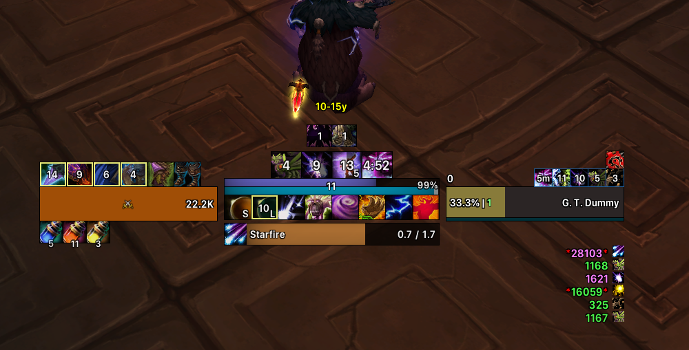 
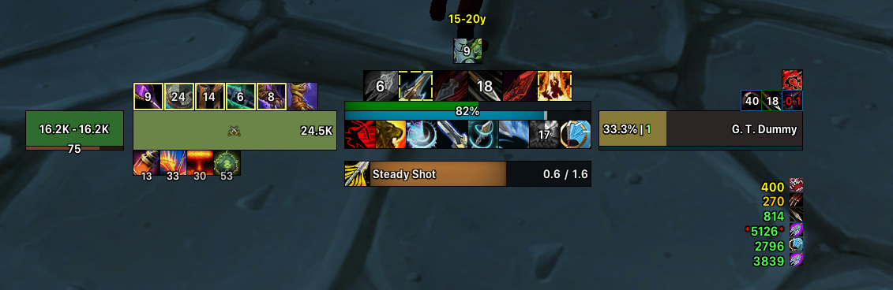 
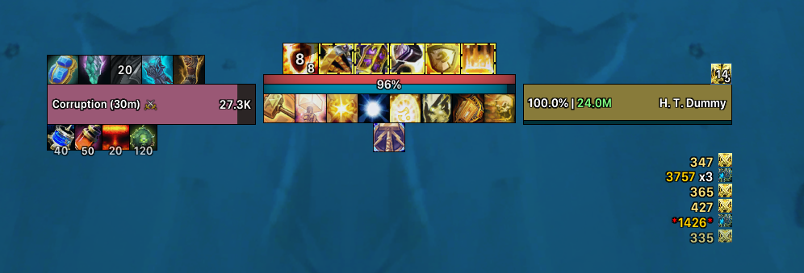

# Interface & Action Bars

### ElvUI

ElvUI is a complete Blizzard UI replacement with built-in unit frames, action bars and matching skins. It has a large selection of plugins, including features that are hard to find in standalone AddOns, making it a community favorite.

🔗 [Download](https://github.com/ElvUI-WotLK/ElvUI/archive/refs/heads/master.zip) &nbsp;|&nbsp; 💻 [Plugins for ElvUI](docs/elvui-plugins/README.md) · [MyPlugin List](https://github.com/NoM0Re/WoW-3.3.5a-Addons/raw/main/src/Addons/Plugins.zip) · [GitHub](https://github.com/ElvUI-WotLK/ElvUI) &nbsp;|&nbsp; 

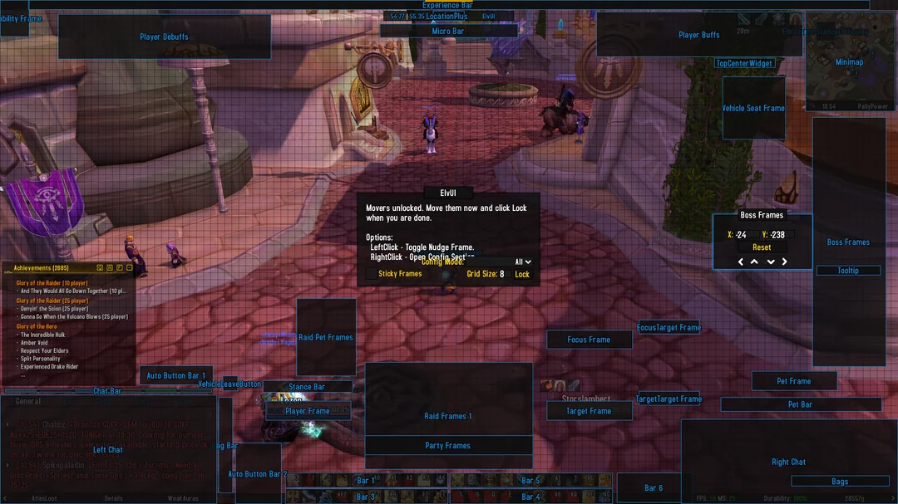

---

### DragonUI

DragonUI is a modular, retail-inspired UI addon. It includes customizable action bars, unit frames, castbars, XP and reputation bars, chat enhancements, a retail-style minimap, bag sorting, layout presets, editor mode, and profile support.

🔗 [Download](https://github.com/NeticSoul/DragonUI/archive/refs/heads/main.zip) &nbsp;|&nbsp; 💻 [GitHub](https://github.com/NeticSoul/DragonUI) &nbsp;|&nbsp; 

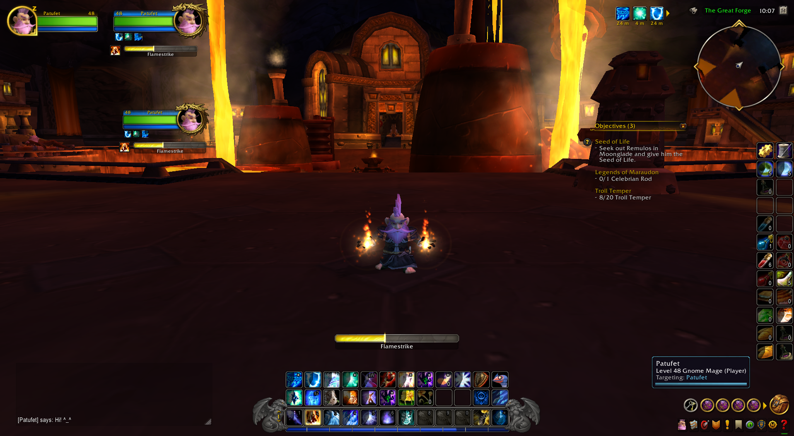

---

### BlizzMove

This addon makes the Blizzard windows movable.

🔗 [Download](https://github.com/NoM0Re/WoW-3.3.5a-Addons/raw/main/src/Addons/BlizzMove.zip) &nbsp;|&nbsp; 💻 [Curseforge](https://www.curseforge.com/wow/addons/blizzmove) &nbsp;|&nbsp; 

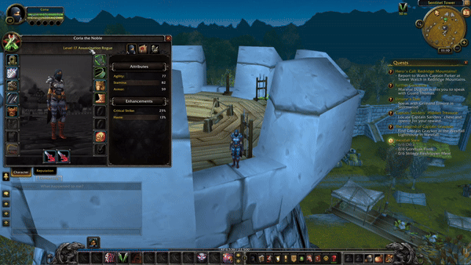

---

### Dominos

Dominos replaces your main bar with movable parts that offer additional customization. It is used primarily for its action bars.

🔗 [Download](https://github.com/bkader/Dominos/archive/refs/heads/main.zip) &nbsp;|&nbsp; 💻 [GitHub](https://github.com/bkader/Dominos) &nbsp;|&nbsp; 

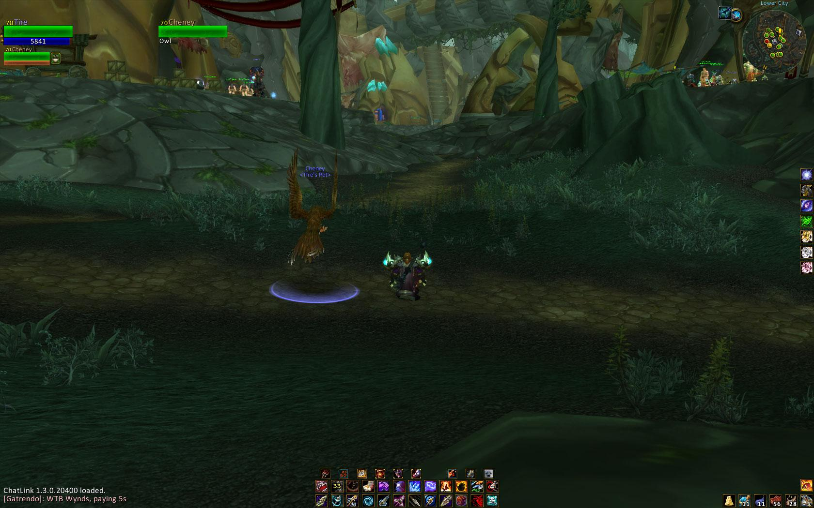

---

### MoveAnything

MoveAnything enables you to move, scale, hide and adjust transparency of just about any screen element in WoW, offering tools to help you customize your UI.

🔗 [Download](https://github.com/sirus-addons/MoveAnything/archive/refs/heads/master.zip) &nbsp;|&nbsp; 💻 [GitHub](https://github.com/sirus-addons/MoveAnything) &nbsp;|&nbsp; 

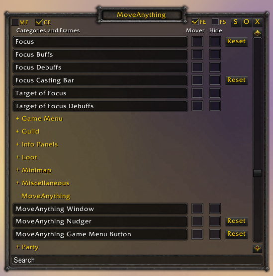

---

### Bartender4

Bartender4 replaces the default action bars with movable, customizable bars for your actions and related controls.

🔗 [Download](https://github.com/NoM0Re/WoW-3.3.5a-Addons/raw/main/src/Addons/Bartender4.zip) &nbsp;|&nbsp; 💻 [Curseforge](https://www.curseforge.com/wow/addons/bartender4/files/all?filter-game-version=2020709689%3A98) &nbsp;|&nbsp; 

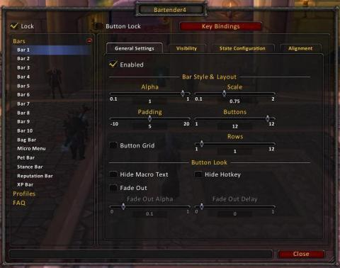

---

### SnowfallKeyPress

SnowfallKeyPress makes keybindings activate when you press a key instead of when you release it.

> ⚠️ Do not use with ElvUI.

🔗 [Download](https://github.com/NoM0Re/WoW-3.3.5a-Addons/raw/main/src/Addons/SnowfallKeyPress.zip) &nbsp;|&nbsp; 💻 [WoWInterface](https://web.archive.org/web/20100108081918/http://www.wowinterface.com:80/downloads/info15078-SnowfallKeyPress.html) &nbsp;|&nbsp; 

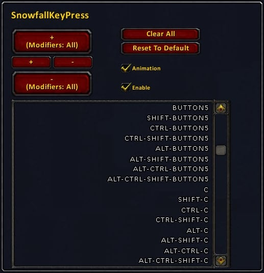

---

### OPie

OPie groups spells, items and other actions into radial rings. Hold a key or mouse binding to show a ring, move the cursor to an action and release the binding to use it.

🔗 [Download](https://github.com/NoM0Re/WoW-3.3.5a-Addons/raw/main/src/Addons/OPie.zip) &nbsp;|&nbsp; 💻 [WotLKAddOns](https://wotlkaddons.com/addon/opie) &nbsp;|&nbsp; 

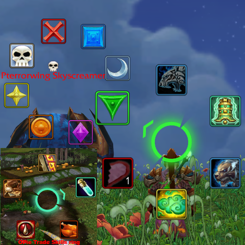

---

### Color Picker Advanced

Color Picker Advanced replaces the default color picker with class-color presets and copy-and-paste support.

🔗 [Download](https://github.com/NoM0Re/WoW-3.3.5a-Addons/raw/main/src/Addons/ColorPickerAdvanced.zip) &nbsp;|&nbsp; 💻 [Google Drive](https://drive.google.com/file/d/1ymNYizWp2TxIS1a6hLg7bT9YoJ3E-8Na/view) &nbsp;|&nbsp; 

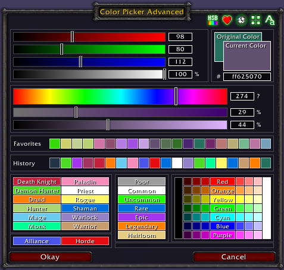

# Unit Frames

### Cell

Cell is a highly customizable party and raid frame addon with automatic layouts, built-in click-casting, aura and raid-debuff indicators, ready checks, death reports, and other raid tools. Open its options with `/cell`.

🔗 [Download](https://github.com/NoM0Re/Cell-WotLK/releases/latest/download/Cell.zip) &nbsp;|&nbsp; 💻 [GitHub](https://github.com/NoM0Re/Cell-WotLK) &nbsp;|&nbsp; 

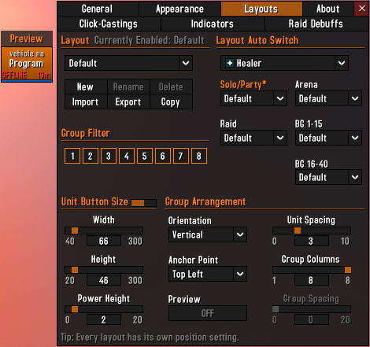

---

### Compact Raid Frame

Compact Raid Frame brings the compact group frames from WoW Classic to 3.3.5a, with configurable layouts, sizes, class colors, profiles, and raid-management tools. **Requires:** [ClassicAPI](https://gitlab.com/tsoukie-3.3.5/classicapi/-/archive/main/classicapi-main.zip)

> **Requires: [ClassicAPI](https://gitlab.com/tsoukie-3.3.5/classicapi/-/archive/main/classicapi-main.zip)**

🔗 [Download](https://gitlab.com/tsoukie-3.3.5/compactraidframe/-/archive/main/compactraidframe-main.zip) &nbsp;|&nbsp; 💻 [ClassicAPI](https://gitlab.com/tsoukie-3.3.5/classicapi/-/archive/main/classicapi-main.zip) · [Plugins for Compact Raid Frame](docs/compact-raid-frame-plugins/README.md) · [GitLab](https://gitlab.com/tsoukie-3.3.5/compactraidframe) &nbsp;|&nbsp; 

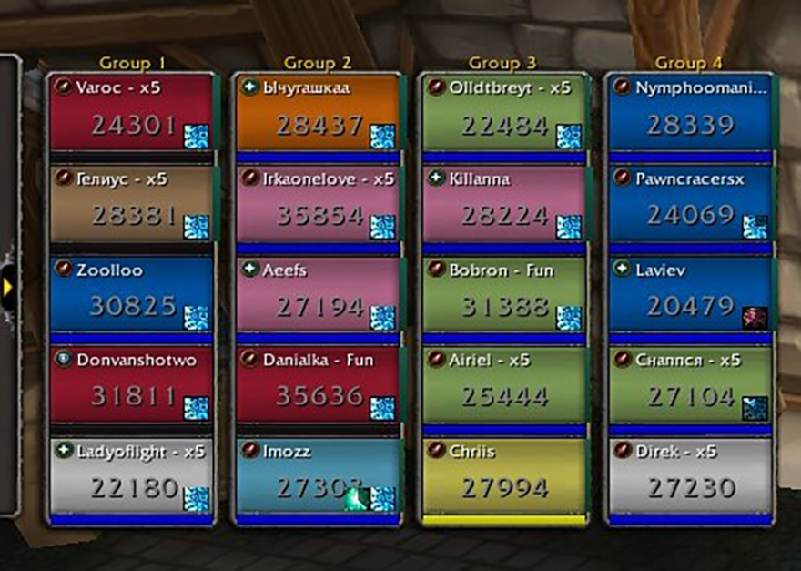

---

### Grid2

Grid2 is a party/raid unit frame addon.

🔗 [Download](https://github.com/bkader/Grid2-WoTLK/archive/refs/heads/main.zip) &nbsp;|&nbsp; 💻 [GitHub](https://github.com/bkader/Grid2-WoTLK) &nbsp;|&nbsp; 

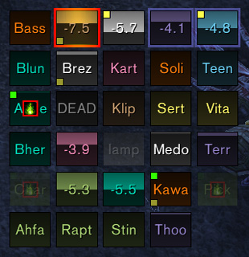

---

### VuhDo

VuhDo displays party and raid members in customizable healing frames, making it easier to monitor their health.

🔗 [Download](https://github.com/NoM0Re/WoW-3.3.5a-Addons/raw/main/src/Addons/VuhDo.zip) &nbsp;|&nbsp; 💻 [RisingGodsAddons](https://addons.rising-gods.de/addons/vuhdo) &nbsp;|&nbsp; 

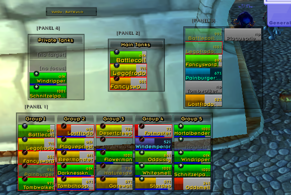

---

### Healbot

HealBot provides customizable healing bars with tools for healing, dispelling, buffing and resurrection. It also supports range checking and threat tracking.

🔗 [Download](https://github.com/NoM0Re/WoW-3.3.5a-Addons/raw/main/src/Addons/HealBot.zip) &nbsp;|&nbsp; 💻 [WotLKDB](https://wotlkdb.com/addons/healbot-continued/) &nbsp;|&nbsp; 

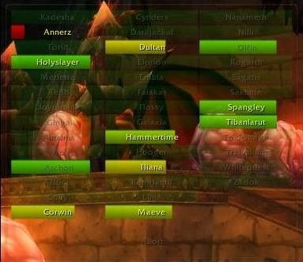

---

### Shadowed Unit Frames

Shadowed Unit Frames (SUF) provides customizable unit frames with range and aura indicators. Move and configure the frames to suit your layout.

🔗 [Download](https://github.com/NoM0Re/WoW-3.3.5a-Addons/raw/main/src/Addons/ShadowedUnitFrames.zip) &nbsp;|&nbsp; 💻 [Curseforge](https://www.curseforge.com/wow/addons/shadowed-unit-frames/files/all?page=1&pageSize=20&version=3.3.5) &nbsp;|&nbsp; 

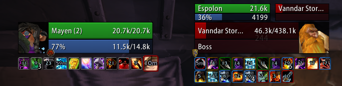
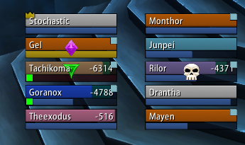

---

### Raeli's Unit Frames

Raeli's Unit Frames (RUF) is a configurable unit-frame AddOn built on oUF.

🔗 [Download](https://github.com/bkader/RUF-WoTLK/archive/refs/heads/main.zip) &nbsp;|&nbsp; 💻 [Github](https://github.com/bkader/RUF-WoTLK) &nbsp;|&nbsp; 

---

### Clique

Clique enables click-casting and mouseover casting on unit frames without requiring separate macros. Bind mouse buttons or key combinations directly to spells and use them on Compact Raid Frame and other supported unit frames. **Requires:** [ClassicAPI](https://gitlab.com/tsoukie-3.3.5/classicapi/-/archive/main/classicapi-main.zip)

> **Requires: [ClassicAPI](https://gitlab.com/tsoukie-3.3.5/classicapi/-/archive/main/classicapi-main.zip)**

🔗 [Download](https://gitlab.com/tsoukie-3.3.5/clique/-/archive/main/clique-main.zip) &nbsp;|&nbsp; 💻 [ClassicAPI](https://gitlab.com/tsoukie-3.3.5/classicapi/-/archive/main/classicapi-main.zip) · [GitLab](https://gitlab.com/tsoukie-3.3.5/clique) &nbsp;|&nbsp; 

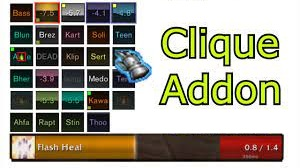

---

### BigDebuffs

BigDebuffs makes important crowd-control and defensive effects easier to see by placing duration icons on unit frames and enlarging priority debuffs on Compact Raid Frame. **Requires:** [ClassicAPI](https://gitlab.com/tsoukie-3.3.5/classicapi/-/archive/main/classicapi-main.zip)

> **Requires: [ClassicAPI](https://gitlab.com/tsoukie-3.3.5/classicapi/-/archive/main/classicapi-main.zip)**

🔗 [Download](https://gitlab.com/tsoukie-3.3.5/bigdebuffs/-/archive/main/bigdebuffs-main.zip) &nbsp;|&nbsp; 💻 [ClassicAPI](https://gitlab.com/tsoukie-3.3.5/classicapi/-/archive/main/classicapi-main.zip) · [GitLab](https://gitlab.com/tsoukie-3.3.5/bigdebuffs) &nbsp;|&nbsp; 

---

### OmniCD

OmniCD tracks party and raid members' spell and item cooldowns in real time. Its customizable icons and extra bars can attach to popular unit frames, including Compact Raid Frame. **Requires:** [ClassicAPI](https://gitlab.com/tsoukie-3.3.5/classicapi/-/archive/main/classicapi-main.zip)

> **Requires: [ClassicAPI](https://gitlab.com/tsoukie-3.3.5/classicapi/-/archive/main/classicapi-main.zip)**

🔗 [Download](https://gitlab.com/tsoukie-3.3.5/omnicd/-/archive/main/omnicd-main.zip) &nbsp;|&nbsp; 💻 [ClassicAPI](https://gitlab.com/tsoukie-3.3.5/classicapi/-/archive/main/classicapi-main.zip) · [GitLab](https://gitlab.com/tsoukie-3.3.5/omnicd) &nbsp;|&nbsp; 

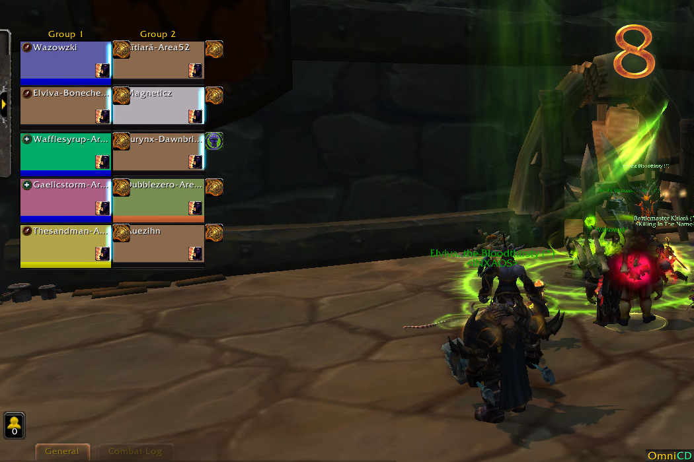

---

### Decursive

Decursive helps classes with dispel abilities identify and remove harmful effects from group members.

🔗 [Download](https://github.com/NoM0Re/WoW-3.3.5a-Addons/raw/main/src/Addons/Decursive.zip) &nbsp;|&nbsp; 💻 [Curseforge](https://www.curseforge.com/wow/addons/decursive/files/all?filter-game-version=2020709689%3A98) &nbsp;|&nbsp; 

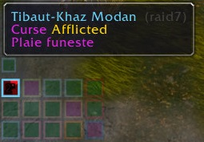

## Boss Mods & Raid Tools

### DBM Deadly Boss Mods Warmane

Deadly Boss Mods (DBM) is a popular addon that assists players in tracking and reacting to the many boss mechanics one might encounter during a dungeon or raid. [How to install for the first time](https://github.com/Zidras/DBM-Warmane#how-to-install-for-the-first-time)

🔗 [Download](https://github.com/Zidras/DBM-Warmane/archive/refs/heads/main.zip) &nbsp;|&nbsp; 💻 [How to install for the first time](https://github.com/Zidras/DBM-Warmane#how-to-install-for-the-first-time) · [Github](https://github.com/Zidras/DBM-Warmane) &nbsp;|&nbsp; 

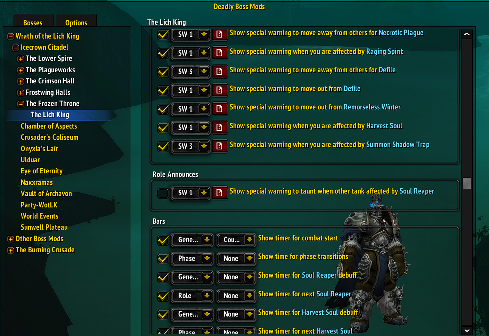

---

### AmILockedOut

AmILockedOut tracks which of your characters are saved to each instance, helping you keep track of raid and dungeon lockouts.

🔗 [Download](https://github.com/NoM0Re/WoW-3.3.5a-Addons/raw/main/src/Addons/AmILockedOut.zip) &nbsp;|&nbsp; 💻 [Curseforge](https://www.curseforge.com/wow/addons/ailo/files/all?filter-game-version=2020709689%3A98) &nbsp;|&nbsp; 

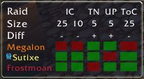

---

### SavedInstances

SavedInstances tracks raid and instance lockouts across all your characters. Hover over its minimap or Data Broker icon to quickly see which characters are saved to which instances, making it a lightweight alternative to AmILockedOut.

🔗 [Download](https://github.com/NoM0Re/WoW-3.3.5a-Addons/raw/main/src/Addons/SavedInstances.zip) &nbsp;|&nbsp; 💻 [CurseForge](https://www.curseforge.com/wow/addons/saved_instances/files/409339) &nbsp;|&nbsp; 

---

### KRU - Kader's Raid Utilities

KRU is a standalone collection of eight raid-utility modules originally included in [KPack](https://github.com/bkader/KPack). [More Information](https://github.com/bkader/KRU-WoTLK)

🔗 [Download](https://github.com/NoM0Re/WoW-3.3.5a-Addons/raw/main/src/Addons/KRU.zip) &nbsp;|&nbsp; 💻 [KPack](https://github.com/bkader/KPack) · [More Information](https://github.com/bkader/KRU-WoTLK) · [Github](https://github.com/bkader/KRU-WoTLK) &nbsp;|&nbsp; 

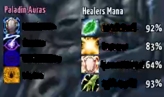

---

### Method Raid Tools (MRT)

Method Raid Tools provides tools for raiders, raid leaders and officers. Its modules include raid cooldowns, notes, reminders, combat logs, raid inspection, attendance tracking, encounter statistics and group management.

🔗 [Download](https://github.com/ExoJdi/Method-Raid-Tools-3.3.5a/archive/refs/heads/main.zip) &nbsp;|&nbsp; 💻 [GitHub](https://github.com/ExoJdi/Method-Raid-Tools-3.3.5a) &nbsp;|&nbsp; 

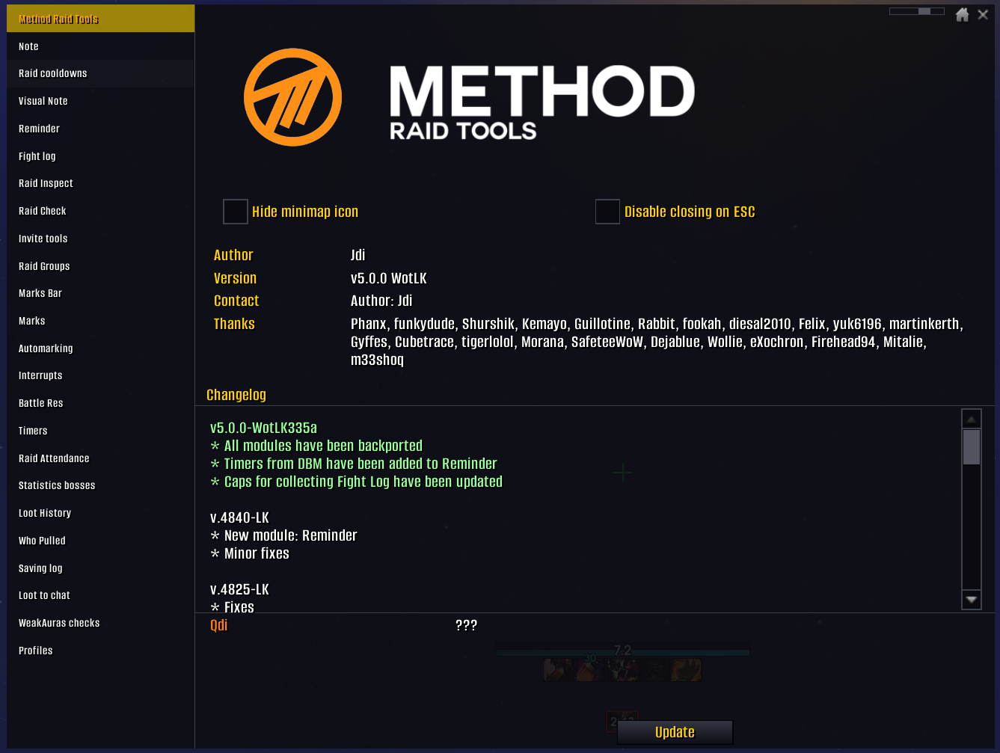

---

### BLT

BLT Raid Cooldowns tracks offensive and defensive raid cooldowns, announces their use and availability, and reports cooldown usage after boss fights. This version also supports trinket cooldowns.

🔗 [Download](https://github.com/NoM0Re/WoW-3.3.5a-Addons/raw/main/src/Addons/BLT.zip) &nbsp;|&nbsp; 💻 [Github](https://github.com/freix1/BLT_WotLK) &nbsp;|&nbsp; 

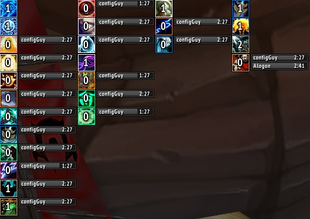

---

### Raelis Spell Announcer

Raeli's Spell Announcer (RSA) announces selected spell casts in chat, including interrupts, defensive cooldowns and utility abilities such as Soulstone.

🔗 [Download](https://github.com/NoM0Re/WoW-3.3.5a-Addons/raw/main/src/Addons/RSA.zip) &nbsp;|&nbsp; 💻 [GitHub](https://github.com/alchem1ster/WotLK-RSA) &nbsp;|&nbsp; 

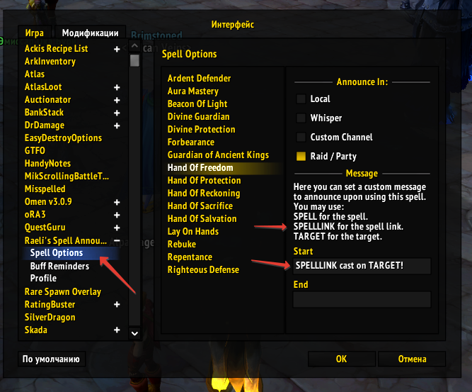

---

### RaidBuffStatus

RaidBuffStatus checks raid readiness and reports missing buffs, consumables, low mana and AFK players through a configurable dashboard or group chat.

🔗 [Download](https://github.com/NoM0Re/WoW-3.3.5a-Addons/raw/main/src/Addons/RaidBuffStatus.zip) &nbsp;|&nbsp; 💻 [Curseforge](https://www.curseforge.com/wow/addons/raidbuffstatus/files/all?filter-game-version=2020709689%3A98) &nbsp;|&nbsp; 

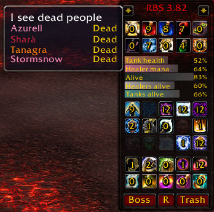

---

### RaidComp

RaidComp gives raid leaders an overview of their group composition and the buffs and debuffs it can provide, helping identify missing coverage.

🔗 [Download](https://github.com/NoM0Re/WoW-3.3.5a-Addons/raw/main/src/Addons/RaidComp.zip) &nbsp;|&nbsp; 💻 [Curseforge](https://www.curseforge.com/wow/addons/arc/files/all?filter-game-version=2020709689%3A93) &nbsp;|&nbsp; 

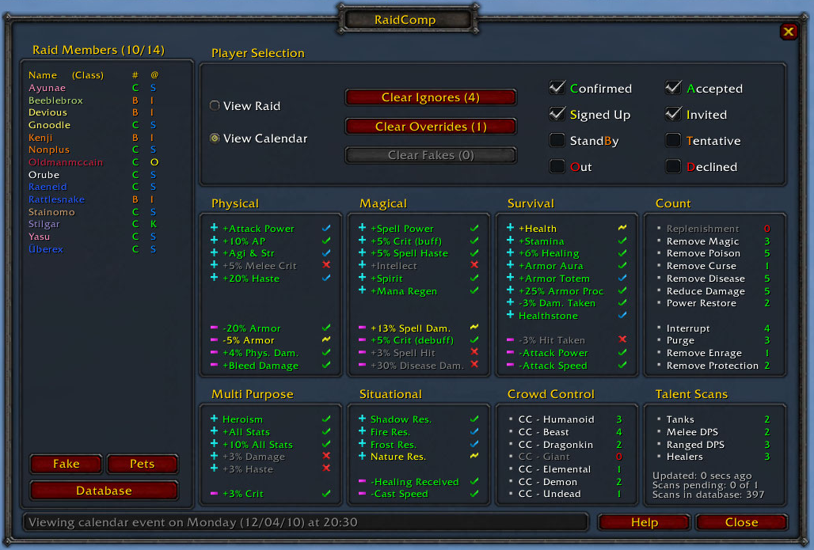

---

### KRT: Kader Raid Tools

KRT provides a collection of raid tools designed to help raid leaders manage their group. [More Information](https://github.com/bkader/KRT)

🔗 [Download](https://github.com/bkader/KRT/archive/refs/heads/main.zip) &nbsp;|&nbsp; 💻 [More Information](https://github.com/bkader/KRT) · [Github](https://github.com/bkader/KRT) &nbsp;|&nbsp; 

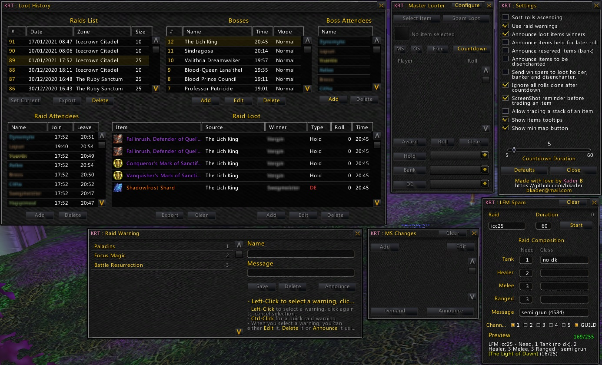

---

### Raid Roll

Raid Roll assigns an ID to each raid member, performs a roll and announces the winner. It can also track player rolls for dropped loot.

🔗 [Download](https://github.com/NoM0Re/WoW-3.3.5a-Addons/raw/main/src/Addons/RaidRoll.zip) &nbsp;|&nbsp; 💻 [Curseforge](https://legacy.curseforge.com/wow/addons/raid-roll/files/all?filter-game-version=2020709689%3A98) &nbsp;|&nbsp; 

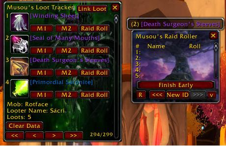

---

### PhoenixStyle

PhoenixStyle tracks raid mistakes and other boss-fight information to help raid leaders review encounters.

🔗 [Download](https://github.com/NoM0Re/WoW-3.3.5a-Addons/raw/main/src/Addons/PhoenixStyle.zip) &nbsp;|&nbsp; 💻 [RisingGods](https://addons.rising-gods.de/addons/phoenix-style) &nbsp;|&nbsp; 

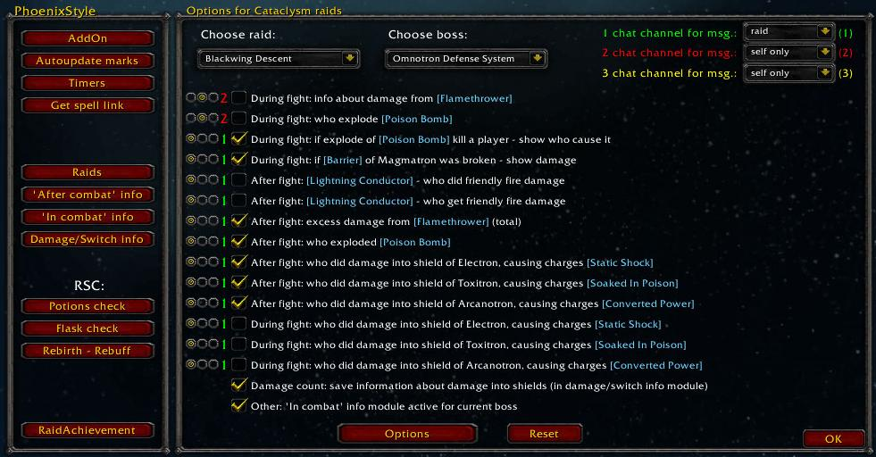

---

### GTFO: Stop standing in fire!

GTFO plays audible warnings when you stand in harmful effects, helping you react to avoidable damage in dungeons and raids.

🔗 [Download](https://github.com/NoM0Re/WoW-3.3.5a-Addons/raw/main/src/Addons/GTFO.zip) &nbsp;|&nbsp; 💻 [Curseforge](https://www.curseforge.com/wow/addons/gtfo) &nbsp;|&nbsp; 

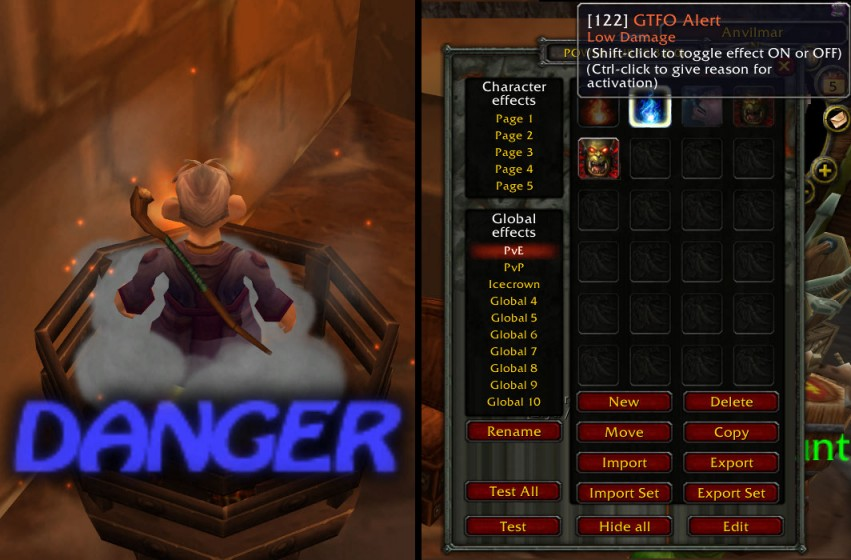

---

### RaidSlackCheck

RaidSlackCheck tracks raid potion use, missing flasks and food buffs, and buffs after a combat resurrection. It is a standalone part of PhoenixStyle.

🔗 [Download](https://github.com/NoM0Re/WoW-3.3.5a-Addons/raw/main/src/Addons/RaidSlackCheck.zip) &nbsp;|&nbsp; 💻 [Warperia](https://warperia.com/addon-wotlk/raidslackcheck/) &nbsp;|&nbsp; 

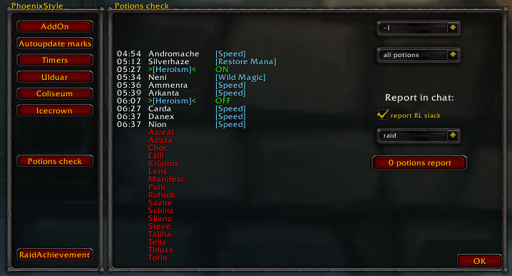

---

### EnsidiaFails

EnsidiaFails reports mistakes made by players during raid encounters.

🔗 [Download](https://github.com/NoM0Re/WoW-3.3.5a-Addons/raw/main/src/Addons/EnsidiaFails.zip) &nbsp;|&nbsp; 💻 [CurseForge](https://www.curseforge.com/wow/addons/ensidiafails) &nbsp;|&nbsp; 

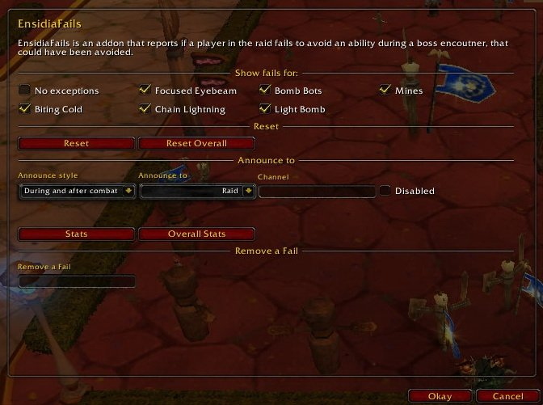

---

### AutoInvite

AutoInvite invites players to your party or raid when they use configured trigger words in selected chat channels. Open the options with `/ai` or `/autoinvite`.

🔗 [Download](https://github.com/NoM0Re/WoW-3.3.5a-Addons/raw/main/src/Addons/AutoInvite.zip) &nbsp;|&nbsp; 💻 [WowAce](https://www.wowace.com/projects/autoinvite-martag/) &nbsp;|&nbsp; 

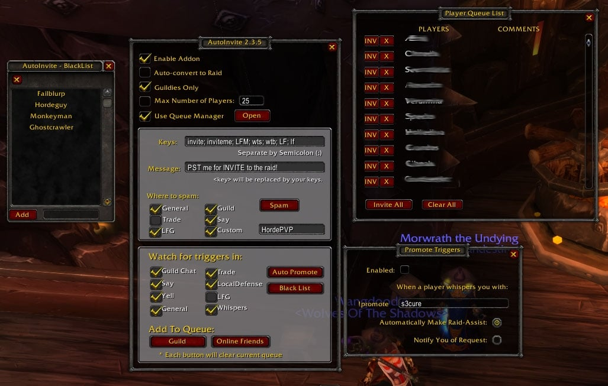

---

### HalionHelper

Provides a clearer visual display of the Corporeality buff during phase 3 of the Halion encounter in Ruby Sanctum. Similar to the PVP capture frame, this lets you easily see if you should be DPSing more, less, or the same.

🔗 [Download](https://github.com/bkader/HalionHelper-WoTLK/archive/refs/heads/main.zip) &nbsp;|&nbsp; 💻 [GitHub](https://github.com/bkader/HalionHelper-WoTLK) &nbsp;|&nbsp; 

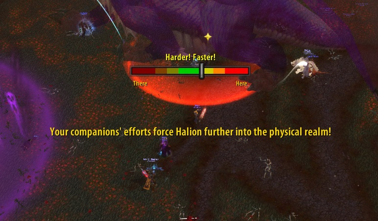

---

### DocsCorporeality(IMO better than HalionHelper)

DocsCorporeality helps you track Corporeality during phase 3 of the Halion encounter in Ruby Sanctum.

🔗 [Download](https://github.com/NoM0Re/WoW-3.3.5a-Addons/raw/main/src/Addons/DocsCorporeality_r3.zip) &nbsp;|&nbsp; 💻 [Curseforge](https://www.curseforge.com/wow/addons/docscorporeality) &nbsp;|&nbsp; 

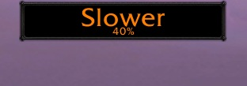

---

### AutomaticWeaponRemoval

AutomaticWeaponRemoval can unequip melee weapons when you are mind-controlled during supported encounters. It also offers features such as removing Righteous Fury when you are not tanking. Configure it through the interface or `/awr`.

🔗 [Download](https://github.com/SecretX33/AutomaticWeaponRemoval/archive/refs/heads/main.zip) &nbsp;|&nbsp; 💻 [Github](https://github.com/SecretX33/AutomaticWeaponRemoval/) &nbsp;|&nbsp; 

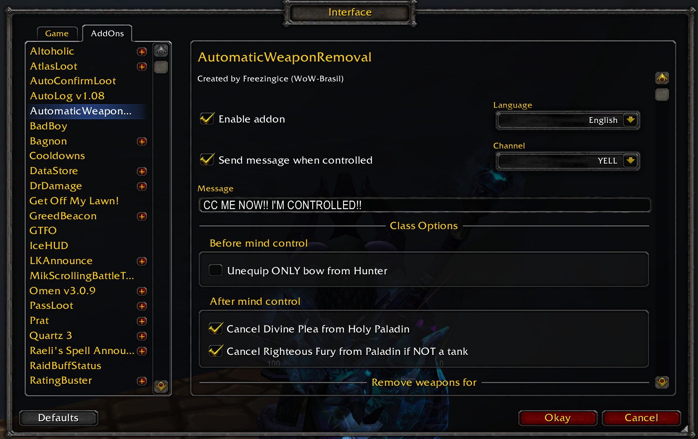

## Damage Meters, Auras & Combat Info

### Critline

Critline records your highest hits, critical strikes, heals and pet attacks. It includes record tooltips, filters, a standalone window and alerts for new records.

🔗 [Download](https://github.com/NoM0Re/WoW-3.3.5a-Addons/raw/main/src/Addons/Critline.zip) &nbsp;|&nbsp; 💻 [Curseforge](https://www.curseforge.com/wow/addons/critline) &nbsp;|&nbsp; 

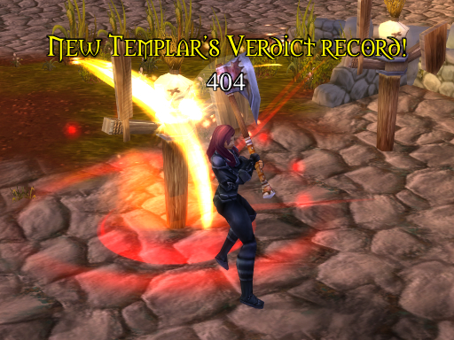

---

### Skada vs. Details!

Skada is the recommended choice for WotLK 3.3.5a. Both AddOns track damage, healing and other combat stats, but the current Details! port can use more CPU and memory, making Skada the better option for performance.

> ⚠️ Use only one damage meter at a time.

🔗 [Download Skada](https://github.com/bkader/Skada-WoTLK/archive/refs/heads/main.zip) · [Download Details!](https://github.com/Bunny67/Details-WotLK/archive/refs/heads/master.zip) &nbsp;|&nbsp; 💻 [Skada Github](https://github.com/bkader/Skada-WoTLK) · [Details! Github](https://github.com/Bunny67/Details-WotLK) &nbsp;|&nbsp; 

---

### Omen Threat Meter

Omen displays threat levels so you can see which players are most likely to draw enemy attacks.

🔗 [Download](https://github.com/NoM0Re/WoW-3.3.5a-Addons/raw/main/src/Addons/Omen.zip) &nbsp;|&nbsp; 💻 [WotLKAddOns](https://wotlkaddons.com/addon/omen) &nbsp;|&nbsp; 

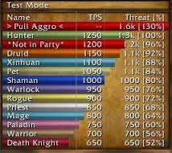

---

### WeakAuras

WeakAuras lets you create customizable displays for buffs, debuffs, cooldowns and other combat information. Use icons, bars, text, sounds and other visuals to track the information you need.

🔗 [Download latest](https://github.com/NoM0Re/WeakAuras-WotLK/releases/latest/download/WeakAuras2.zip) &nbsp;|&nbsp; 💻 [GitHub](https://github.com/NoM0Re/WeakAuras-WotLK) &nbsp;|&nbsp; 

---

### TellMeWhen

TellMeWhen is a WoW addon that provides visual, auditory, and textual notifications about cooldowns, buffs, and pretty much every other element of combat.

🔗 [Download](https://github.com/bkader/TellMeWhen_3.3.5/archive/refs/heads/main.zip) &nbsp;|&nbsp; 💻 [Curseforge](https://github.com/bkader/TellMeWhen_3.3.5) &nbsp;|&nbsp; 

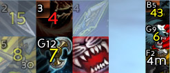

---

### NeedToKnow

NeedToKnow lets you monitor specific buffs, debuffs, cooldowns, and totems as timer bars that always appear in a consistent place on your screen.

🔗 [Download](https://github.com/NoM0Re/WoW-3.3.5a-Addons/raw/main/src/Addons/NeedToKnow.zip) &nbsp;|&nbsp; 💻 [Curseforge](https://www.curseforge.com/wow/addons/need-to-know/files/all?filter-game-version=2020709689%3A98) &nbsp;|&nbsp; 

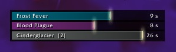

---

### EventHorizon

EventHorizon displays your class and specialization's rotational abilities on a shared timeline, making it easier to see how their timings overlap.

🔗 [Download](https://github.com/NoM0Re/WoW-3.3.5a-Addons/raw/main/src/Addons/EventHorizon.zip) &nbsp;|&nbsp; 💻 [Curseforge](https://www.curseforge.com/wow/addons/eventhorizon) &nbsp;|&nbsp; 

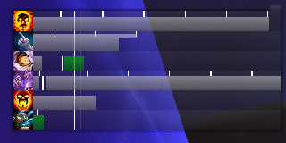

---

### ForteXorcist

ForteXorcist tracks damage-over-time effects on multiple targets and provides additional tools for warlocks and priests.

🔗 [Download](https://github.com/NoM0Re/WoW-3.3.5a-Addons/raw/main/src/Addons/ForteXorcist.zip) &nbsp;|&nbsp; 💻 [RisingGods](https://addons.rising-gods.de/addons/fortexorcist) &nbsp;|&nbsp; 

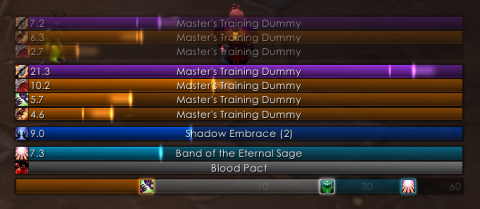

---

### OmniCC

Adds numeric cooldown timers to spells, abilities, and items, turning the default analog cooldown swirl into clear digital countdown text. Works with the default UI and most addons. Use /omnicc or /occ to open the options.

🔗 [Download](https://github.com/NoM0Re/OmniCC-WotLK/releases/latest/download/OmniCC.zip) &nbsp;|&nbsp; 💻 [Github](https://github.com/NoM0Re/OmniCC-WotLK) &nbsp;|&nbsp; 

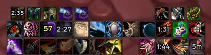

---

### Cooldowns

A World of Warcraft add-on that displays numeric cooldown counters on all buttons that are 28 pixels or wider.

🔗 [Download](https://github.com/NoM0Re/WoW-3.3.5a-Addons/raw/main/src/Addons/cooldowns.zip) &nbsp;|&nbsp; 💻 [Warperia](https://warperia.com/addon-wotlk/cooldowns/) &nbsp;|&nbsp; 

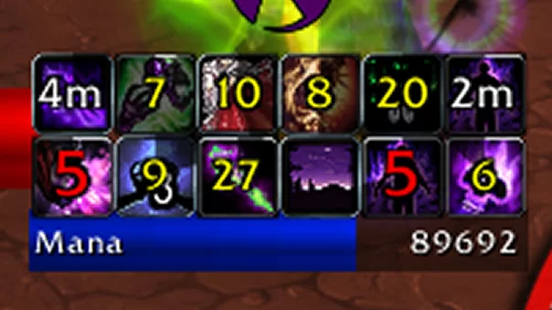

---

### Quartz

Quartz provides modular casting bars for tracking spell casts and channeling.

🔗 [Download](https://github.com/NoM0Re/WoW-3.3.5a-Addons/raw/main/src/Addons/Quartz.zip) &nbsp;|&nbsp; 💻 [RisingGodsAddons](https://addons.rising-gods.de/addons/quartz) &nbsp;|&nbsp; 

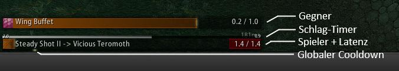

---

### SexyCooldown

SexyCooldown is a single consolidated timer bar for all your spell, pet's spell, item, and proc cooldowns, as well as buffs, debuffs, and totem timers. It's very flexible, and can be customized to fit into your UI as best you see fit.

🔗 [Download](https://github.com/NoM0Re/WoW-3.3.5a-Addons/raw/main/src/Addons/SexyCooldown.zip) &nbsp;|&nbsp; 💻 [Curseforge](https://www.curseforge.com/wow/addons/sexycooldown/files?version=3.3.3) &nbsp;|&nbsp; 

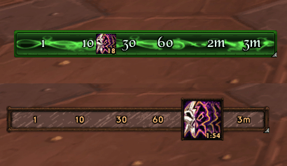

---

### Cheese

Cheese adds Cataclysm-style visual alerts for ability procs.

🔗 [Download](https://github.com/NoM0Re/WoW-3.3.5a-Addons/raw/main/src/Addons/Cheese.zip) &nbsp;|&nbsp; 💻 [WotLKAddOns](https://wotlkaddons.com/addon/cheese) &nbsp;|&nbsp; 

---

### DrDamage

DrDamage calculates the damage or healing of your abilities, taking talents, gear and buffs into account. It displays the results on action buttons and adds detailed statistics to spellbook and action-bar tooltips.

🔗 [Download](https://github.com/NoM0Re/WoW-3.3.5a-Addons/raw/main/src/Addons/DrDamage.zip) &nbsp;|&nbsp; 💻 [WotLKAddOns](https://wotlkaddons.com/addon/drdamage) &nbsp;|&nbsp; 

---

### MikScrollingBattleText(MSBT)

MikScrollingBattleText (MSBT) replaces Blizzard's floating combat text with configurable scrolling areas for damage, healing and other combat information.

🔗 [Download](https://github.com/NoM0Re/WoW-3.3.5a-Addons/raw/main/src/Addons/MikScrollingBattleText.zip) &nbsp;|&nbsp; 💻 [WotLKAddOns](https://wotlkaddons.com/addon/mik%27s-scrolling-battle-text) &nbsp;|&nbsp; 

---

### xCT+

xCT+ replaces the default combat text with a configurable display backported from Mists of Pandaria. It includes in-game options for a cleaner, less cluttered layout.

🔗 [Download](https://github.com/hypopheria2k/xCT_Plus_wotlk/archive/refs/heads/master.zip) &nbsp;|&nbsp; 💻 [GitHub](https://github.com/hypopheria2k/xCT_Plus_wotlk) &nbsp;|&nbsp; 

---

### ClassicNumbers

ClassicNumbers replaces the default floating damage text with the classic popping animation. It offers configurable size, transparency, duration, scroll speed, damage-school colors, number shortening, and filters for small hits and critical strikes. Open its options with `/cn`.

🔗 [Download](https://github.com/NoM0Re/ClassicNumbers-WotLK/archive/refs/heads/main.zip) &nbsp;|&nbsp; 💻 [GitHub](https://github.com/NoM0Re/ClassicNumbers-WotLK) &nbsp;|&nbsp; 

---

### SpellReplay

SpellReplay displays a scrolling history of recently used abilities, similar to TrufiGCD. The display speeds up when several spells are used together, making it useful for streams and gameplay reviews.

🔗 [Download](https://github.com/NoM0Re/WoW-3.3.5a-Addons/raw/main/src/Addons/SpellReplay.zip) &nbsp;|&nbsp; 💻 [Warperia](https://warperia.com/addon-wotlk/spellreplay/) &nbsp;|&nbsp; 

---

### TrufiGCD

TrufiGCD displays recently used abilities for you, party members and arena players. It can also show your spell history on streams.

🔗 [Download](https://github.com/NoM0Re/WoW-3.3.5a-Addons/raw/main/src/Addons/TrufiGCD.zip) &nbsp;|&nbsp; 💻 [GitHub](https://github.com/BannZay/TrufiGCD) &nbsp;|&nbsp; 

## Nameplates

### Tidy Plates

Tidy Plates customizes nameplates and displays information such as threat and health percentages.

🔗 [Download](https://github.com/bkader/TidyPlates_WoTLK/archive/refs/heads/main.zip) &nbsp;|&nbsp; 💻 [Github](https://github.com/bkader/TidyPlates_WoTLK) &nbsp;|&nbsp; 

---

### NotPlater

NotPlater is a customizable nameplate AddOn inspired by Plater. It provides detailed threat information and configurable display options. Open its settings with the minimap button, `/np` or `/notplater`.

🔗 [Download](https://github.com/NoM0Re/WoW-3.3.5a-Addons/raw/main/src/Addons/NotPlater-3.3.5.zip) &nbsp;|&nbsp; 💻 [Github](https://github.com/RichSteini/NotPlater) &nbsp;|&nbsp; 

---

### PlateBuffs

PlateBuffs displays buffs and debuffs above enemy nameplates, helping you track important auras in PvP and combat. This version is based on Kader's backport and adds improved spell filtering, duration text options, expiration animations, nameplate tracking, and simulated interrupt debuffs.

🔗 [Download](https://github.com/KhalGH/PlateBuffs-WoTLK/archive/refs/heads/main.zip) &nbsp;|&nbsp; 💻 [GitHub](https://github.com/KhalGH/PlateBuffs-WoTLK) &nbsp;|&nbsp; 

---

### iTargetingFrames

iTargetingFrames displays nameplate units in a clickable grid. It requires a client patched with [AwesomeWotLK](https://github.com/FrostAtom/awesome_wotlk). If units appear more than once, use the modified DLL with fixed nameplate units provided by its repository.

> **Does not work on servers that do not support AwesomeWotLK features (e.g. Warmane).**

🔗 [Download](https://github.com/CH33T4/iTargetingFrames/archive/refs/heads/main.zip) &nbsp;|&nbsp; 💻 [Github](https://github.com/CH33T4/iTargetingFrames) &nbsp;|&nbsp; 

## Quests, Leveling & Immersion

### TurnIn

TurnIn automates quest acceptance, quest turn-ins and selected NPC dialogue options. Open its options with `/ti window`.

🔗 [Download](https://github.com/NoM0Re/WoW-3.3.5a-Addons/raw/main/src/Addons/TurnIn-2.1.zip) &nbsp;|&nbsp; 💻 [Curseforge](https://www.curseforge.com/wow/addons/turn-in/files/all?filter-game-version=2020709689%3A98) &nbsp;|&nbsp; 

---

### Questie

Questie displays quest objectives, NPCs and items on the map and adds helpful quest information to tooltips, making it easier to find and complete quests.

🔗 [Download](https://github.com/Aldori15/Questie/archive/refs/heads/335.zip) &nbsp;|&nbsp; 💻 [Github](https://github.com/Aldori15/Questie) &nbsp;|&nbsp; 

---

### Zygor Guides

Zygor Guides Viewer Remaster is a modernized version of the classic Zygor Guides Viewer, built specifically for World of Warcraft: Wrath of the Lich King (3.3.5a / build 12340) private servers. It preserves the original 3.3.5a guide engine, step system, and waypoint workflow while introducing a cleaner, retail-inspired UI, an improved Guide Manager, updated arrow and objective styling, accessibility options (including colorblind presets), and ongoing compatibility support for WotLK 3.3.5a environments. The addon includes step-by-step leveling guidance, waypoint navigation, structured quest flow, and an integrated Talent Advisor - all packaged in a remastered, streamlined viewer designed for long play sessions.

🔗 [Download](https://github.com/ErebusAres/ZygorGuidesRemaster-3.3.5a_WOTLK/archive/refs/heads/main.zip) &nbsp;|&nbsp; 💻 [Github](https://github.com/ErebusAres/ZygorGuidesRemaster-3.3.5a_WOTLK) &nbsp;|&nbsp; 

---

### Questhelper

QuestHelper uses a database of quests, NPCs and items to show where your objectives are and plan efficient routes between them.

🔗 [Download](https://github.com/NoM0Re/WoW-3.3.5a-Addons/raw/main/src/Addons/QuestHelper.zip) &nbsp;|&nbsp; 💻 [Curseforge](https://www.curseforge.com/wow/addons/quest-helper/files/all?filter-game-version=2020709689%3A98) &nbsp;|&nbsp; 

---

### EveryQuest

EveryQuest tracks your quest history and provides a searchable quest-list window.

🔗 [Download](https://github.com/NoM0Re/WoW-3.3.5a-Addons/raw/main/src/Addons/EveryQuest.zip) &nbsp;|&nbsp; 💻 [WoWAce](https://www.wowace.com/projects/everyquest) &nbsp;|&nbsp; 

---

### Carbonite (Maps / QuestHelper)

Carbonite replaces the world map with a Google Maps-style interface and includes quest-tracking tools.

🔗 [Download](https://github.com/anzz1/Carbonite-3.3.5/archive/refs/heads/master.zip) &nbsp;|&nbsp; 💻 [Github](https://github.com/anzz1/Carbonite-3.3.5) &nbsp;|&nbsp; 

---

### Vd-skip

Vd-skip is a lightweight addon that streamlines NPC interactions by automatically skipping unnecessary dialogue with vendors and flight masters.

🔗 [Download](https://github.com/Stradios/Vd-skip/archive/refs/heads/main.zip) &nbsp;|&nbsp; 💻 [Github](https://github.com/Stradios/Vd-skip) &nbsp;|&nbsp; 

---

### Overachiever

Overachiever provides tools and tweaks to make the lives of players seeking achievements a little bit easier.

🔗 [Download](https://github.com/NoM0Re/WoW-3.3.5a-Addons/raw/main/src/Addons/Overachiever.zip) &nbsp;|&nbsp; 💻 [Curseforge](https://www.curseforge.com/wow/addons/overachiever) &nbsp;|&nbsp; 

---

### What's Training?

What's Training? adds a new spellbook tab that lists every trainable spell for your class. Spells are grouped into categories such as available now, missing requirements, coming soon, and not yet available, with the required level and total training cost shown at a glance.

🔗 [Download](https://github.com/anhility/WhatsTraining_WotLK/archive/refs/heads/master.zip) &nbsp;|&nbsp; 💻 [GitHub](https://github.com/anhility/WhatsTraining_WotLK) &nbsp;|&nbsp; 

---

### Immersion

Immersion replaces the default quest and NPC dialogue windows with a more immersive interface.

🔗 [Download](https://github.com/s0h2x/Immersion-WotLK/archive/refs/heads/master.zip) &nbsp;|&nbsp; 💻 [Github](https://github.com/s0h2x/Immersion-WotLK) &nbsp;|&nbsp; 

---

### Storyline

Storyline replaces the quest window with an immersive dialogue interface featuring animated 3D character models and visual effects.

🔗 [Download latest release](https://github.com/shadovvs/WotLK-Storyline/releases/latest) &nbsp;|&nbsp; 💻 [Github](https://github.com/shadovvs/WotLK-Storyline/tree/v1.0.1) &nbsp;|&nbsp; 

---

### DialogUI

An immersive quest / gossip / book dialog UI for World of Warcraft 3.3.5a.

🔗 [Download](https://github.com/ghbset/DialogUI-WotLK/archive/refs/heads/main.zip) &nbsp;|&nbsp; 💻 [Github](https://github.com/ghbset/DialogUI-WotLK) · [Warperia](https://warperia.com/wotlk-addons/) · [Warperia Microsoft Store App](https://warperia.com/app-download/) · [CurseForge (3.3.5)](https://www.curseforge.com/wow/search?page=1&pageSize=20&sortBy=relevancy&class=addons&version=3.3.5) · [Legacy-WoW](https://legacy-wow.com/wotlk-addons/) · [RG](https://addons.rising-gods.de/addons) &nbsp;|&nbsp; 

## Maps, Minimaps & Atlases

### AtlasLoot Enhanced

AtlasLoot Enhanced lets you browse boss loot tables from within the game.

🔗 [Download](https://github.com/NoM0Re/WoW-3.3.5a-Addons/raw/main/src/Addons/AtlasLoot.zip) &nbsp;|&nbsp; 💻 [Curseforge](https://www.curseforge.com/wow/addons/atlasloot-enhanced/files/all?filter-game-version=2020709689%3A98) &nbsp;|&nbsp; 

---

### Mapster

Mapster improves the world map and is designed to work alongside other map AddOns.

🔗 [Download](https://github.com/NoM0Re/WoW-3.3.5a-Addons/raw/main/src/Addons/Mapster.zip) &nbsp;|&nbsp; 💻 [Curseforge](https://www.curseforge.com/wow/addons/mapster) &nbsp;|&nbsp; 

---

### Cartographer

Cartographer provides a modular framework for customizing and extending the world map.

🔗 [Download](https://github.com/NoM0Re/WoW-3.3.5a-Addons/raw/main/src/Addons/Cartographer.zip) &nbsp;|&nbsp; 💻 [WoWAce](https://www.wowace.com/projects/cartographer) &nbsp;|&nbsp; 

---

### Cromulent

Cromulent displays zone information directly on the world map.

🔗 [Download](https://github.com/NoM0Re/WoW-3.3.5a-Addons/raw/main/src/Addons/Cromulent.zip) &nbsp;|&nbsp; 💻 [WoWAce](https://www.wowace.com/projects/cromulent) &nbsp;|&nbsp; 

---

### pMinimap

pMinimap is a very lightweight and streamlined Minimap addon.

🔗 [Download](https://github.com/NoM0Re/WoW-3.3.5a-Addons/raw/main/src/Addons/pMinimap.zip) &nbsp;|&nbsp; 💻 [Warperia](https://warperia.com/addon-wotlk/pminimap/) &nbsp;|&nbsp; 

---

### CleanMinimap

A clean square or round minimap that replaces the default minimap.

🔗 [Download](https://github.com/NoM0Re/WoW-3.3.5a-Addons/raw/main/src/Addons/CleanMinimap.zip) &nbsp;|&nbsp; 💻 [Curseforge](https://www.curseforge.com/wow/addons/cleanminimap) &nbsp;|&nbsp; 

---

### SexyMap

SexyMap customizes the minimap with a selection of predefined visual styles.

🔗 [Download](https://github.com/NoM0Re/WoW-3.3.5a-Addons/raw/main/src/Addons/SexyMap.zip) &nbsp;|&nbsp; 💻 [Warperia](https://warperia.com/addon-wotlk/sexymap/) &nbsp;|&nbsp; 

---

### pretty_minimap

pretty_minimap is a lightweight minimap AddOn with a Dragonflight-style appearance.

🔗 [Download](https://github.com/s0h2x/pretty_minimap/archive/refs/heads/master.zip) &nbsp;|&nbsp; 💻 [Github](https://github.com/s0h2x/pretty_minimap/) &nbsp;|&nbsp; 

---

### Atlas

Atlas provides detailed dungeon and raid maps with markers for bosses, entrances and other points of interest.

🔗 [Download](https://github.com/NoM0Re/WoW-3.3.5a-Addons/raw/main/src/Addons/Atlas.zip) &nbsp;|&nbsp; 💻 [Rising Gods](https://addons.rising-gods.de/addons/atlas) &nbsp;|&nbsp; 

---

### CartoMapper

CartoMapper combines map reveal, zooming, coordinates, group icons, points of interest, waypoints, instance maps and battlefield-minimap enhancements in one AddOn for WotLK 3.3.5a.

🔗 [Download from the official source](https://github.com/Zendevve/CartoMapper) &nbsp;|&nbsp; 💻 [Github](https://github.com/Zendevve/CartoMapper) &nbsp;|&nbsp; 

---

### Leatrix Maps

Leatrix Maps enhances the world map with a movable borderless window, opacity controls, coordinates, zone and fishing levels, points of interest, quest objectives, map reveal, and configurable zoom and panning. Open its options with `/ltm`.

🔗 [Download](https://github.com/5Buttons/Leatrix-Maps-3.3.5/archive/refs/heads/main.zip) &nbsp;|&nbsp; 💻 [GitHub](https://github.com/5Buttons/Leatrix-Maps-3.3.5) &nbsp;|&nbsp; 

## Bags, Bank & Inventory

### AdiBags

AdiBags combines your bags into a single view and automatically groups items into categories using smart filters.

🔗 [Download](https://github.com/NoM0Re/WoW-3.3.5a-Addons/raw/main/src/Addons/AdiBags.zip) &nbsp;|&nbsp; 💻 [Github](https://github.com/Sattva-108/AdiBags-WoTLK-3.3.5) &nbsp;|&nbsp; 

---

### Bagnon Backport with Search and Sort Functionality

Bagnon combines your bags into a single interface with search and sorting features to help you find and organize items.

🔗 [Download](https://github.com/RichSteini/Bagnon-3.3.5/archive/refs/heads/main.zip) &nbsp;|&nbsp; 💻 [Github](https://github.com/RichSteini/Bagnon-3.3.5) &nbsp;|&nbsp; 

---

### OmniInventory

OmniInventory combines your bags, bank, and guild bank in one searchable interface with category, list, and grid views. It also supports offline character inventories, sorting, item overlays, automatic junk selling, and repairs.

🔗 [Download from the official source](https://github.com/Zendevve/OmniInventory) &nbsp;|&nbsp; 💻 [GitHub](https://github.com/Zendevve/OmniInventory) &nbsp;|&nbsp; 

---

### Ludwig

Ludwig is an in-game item database with search and filtering options, making it easier to find items and compare their properties.

🔗 [Download](https://github.com/NoM0Re/WoW-3.3.5a-Addons/raw/main/src/Addons/Ludwig.zip) &nbsp;|&nbsp; 💻 [Curseforge](https://www.curseforge.com/wow/addons/ludwig) &nbsp;|&nbsp; 

---

### Altoholic

Altoholic keeps information about your other characters in one place, including their bags, mail, auctions, professions and other character details, so you can check it without logging between characters.

🔗 [Download](https://github.com/NoM0Re/WoW-3.3.5a-Addons/raw/main/src/Addons/Altoholic.zip) &nbsp;|&nbsp; 💻 [RisingGods](https://addons.rising-gods.de/addons/altoholic) &nbsp;|&nbsp; 

## Auction House, Economy & Professions

### Gatherer+

Gatherer+ remembers where you have gathered herbs, mined ore or opened containers and records those locations on the map. Open it with `/gather`.

🔗 [Download](https://github.com/NoM0Re/WoW-3.3.5a-Addons/raw/main/src/Addons/Gatherer_Wowhead335.rar) &nbsp;|&nbsp; 💻 [WarmaneForum](https://forum.warmane.com/showthread.php?t=412904) &nbsp;|&nbsp; 

---

### Auctionator (Cata Port Version)

Auctionator simplifies browsing, buying and selling at the Auction House, with clearer listings and easier auction management. This is the Cataclysm-port version for WotLK.

🔗 [Download](https://github.com/alchem1ster/WotLK-Auctionator/archive/refs/heads/main.zip) &nbsp;|&nbsp; 💻 [Github](https://github.com/alchem1ster/WotLK-Auctionator) &nbsp;|&nbsp; 

---

### TradeSkillMaster

TradeSkillMaster is an all-in-one suite for the in-game economy, backported to WotLK 3.3.5a. It includes auction-house scanning and bulk posting, crafting and profit management, item groups and operations, mailing, banking, vendoring, and accounting.

🔗 [Download](https://github.com/Keoo88/TradeSkillMaster-3.3.5-backport/archive/refs/heads/master.zip) &nbsp;|&nbsp; 💻 [Github](https://github.com/Keoo88/TradeSkillMaster-3.3.5-backport) &nbsp;|&nbsp; 

---

### DalaranAH

DalaranAH adds a customizable button for the Auction House NPC in Dalaran. Use it to target, focus or mark the NPC and open the Auction House without manually selecting the dialogue option.

🔗 [Download](https://github.com/NoM0Re/DalaranAH/releases/latest/download/DalaranAH.zip) &nbsp;|&nbsp; 💻 [Github](https://github.com/NoM0Re/DalaranAH/) &nbsp;|&nbsp; 

---

### Emblem of Gold V2

Emblem of Gold is a simple World of Warcraft addon that shows your gold and emblem counts (Heroism, Valor, Conquest, Triumph, Frost) when you open a vendor.

🔗 [Download](https://github.com/Stradios/Emblem-of-Gold/releases/latest) &nbsp;|&nbsp; 💻 [Github](https://github.com/Stradios/Emblem-of-Gold) &nbsp;|&nbsp; 

---

### Postal+

Postal+ adds extra tools for managing your mailbox. This version includes additional features by BlueAo.

🔗 [Download](https://github.com/NoM0Re/WoW-3.3.5a-Addons/raw/main/src/Addons/Postal.zip) &nbsp;|&nbsp; 💻 [Warmane Forum](https://forum.warmane.com/showthread.php?t=412904&p=3057363&viewfull=1#post3057363) &nbsp;|&nbsp; 

---

### Ackis Recipe List

Ackis Recipe List is an AddOn which will scan your trade skills and provide information on how to obtain recipes.

🔗 [Download](https://github.com/NoM0Re/WoW-3.3.5a-Addons/raw/main/src/Addons/AckisRecipeList.zip) &nbsp;|&nbsp; 💻 [Curseforge](https://www.curseforge.com/wow/addons/arl) &nbsp;|&nbsp; 

---

### RecipeColor

RecipeColor colors recipes your character already knows green in bags, banks, mail, trade, loot, and merchant frames. It also supports popular bag and UI addons including AdiBags, Bagnon, DragonUI, and ElvUI.

🔗 [Download latest release](https://github.com/Drakensangs/RecipeColor-WotLK/releases/latest) &nbsp;|&nbsp; 💻 [GitHub](https://github.com/Drakensangs/RecipeColor-WotLK) &nbsp;|&nbsp; 

---

### Improved Profession Capper

Improved Profession Capper suggests which recipes to craft next when leveling your professions. Its recommendations appear alongside the profession window.

🔗 [Download](https://github.com/DarkChimu/Improved-Profession-Capper/archive/refs/heads/master.zip) &nbsp;|&nbsp; 💻 [Github](https://github.com/DarkChimu/Improved-Profession-Capper) &nbsp;|&nbsp; 

---

### Molinari

Molinari lets you perform supported item-processing actions directly from your bags by holding Alt and clicking an item, without opening the profession window or using a macro.

🔗 [Download](https://github.com/NoM0Re/WoW-3.3.5a-Addons/raw/main/src/Addons/Molinari.zip) &nbsp;|&nbsp; 💻 [Curseforge](https://www.curseforge.com/wow/addons/molinari) &nbsp;|&nbsp; 

## Chat, Social & Group Finder

### Chatter

Chatter customizes the chat interface with options such as class-colored names, timestamps, fonts, chat-copying tools and URL copying.

🔗 [Download](https://github.com/NoM0Re/WoW-3.3.5a-Addons/raw/main/src/Addons/Chatter.zip) &nbsp;|&nbsp; 💻 [Curseforge](https://www.curseforge.com/wow/addons/chatter/files/all?filter-game-version=2020709689%3A98) &nbsp;|&nbsp; 

---

### BNetToast

BNetToast shows Battle.net-style online and offline notifications for friends and guild members.

🔗 [Download](https://github.com/NoM0Re/WoW-3.3.5a-Addons/raw/main/src/Addons/BNetToast.zip) &nbsp;|&nbsp; 💻 [Github](https://github.com/crumdidlyumshis/BNetToast) &nbsp;|&nbsp; 

---

### ChatFilter (project abandoned)

ChatFilter hides messages containing words from a configurable blacklist in say, yell and global chat. Edit the blacklist in game to filter unwanted messages.

> ⚠️ Project abandoned — works but no longer updated.

🔗 [Download](https://github.com/NoM0Re/WoW-3.3.5a-Addons/raw/main/src/Addons/ChatFilter.zip) &nbsp;|&nbsp; 💻 [Warmane Forum](https://forum.warmane.com/showthread.php?t=404523) &nbsp;|&nbsp; 

---

### STFU: Shut the fuck up, thanks.

Efficiently blocks all opposite-faction chat spam in neutral cities (Dalaran, Shattrath, etc) and other neutral areas. Still shows their messages if you are outside of neutral zones, to preserve situational awareness of nearby enemies.

🔗 [Download](https://github.com/Arcitec/STFU_Chat_Filter/archive/refs/heads/main.zip) &nbsp;|&nbsp; 💻 [Github](https://github.com/Arcitec/STFU_Chat_Filter) &nbsp;|&nbsp; 

---

### Friend & Ignore Share

Friend & Ignore Share shares your friend and ignore lists across characters on the same account.

🔗 [Download](https://github.com/NoM0Re/WoW-3.3.5a-Addons/raw/main/src/Addons/FriendShare.zip) &nbsp;|&nbsp; 💻 [Curseforge](https://www.curseforge.com/wow/addons/friend-ignore-share) &nbsp;|&nbsp; 

---

### IgnoreMore

IgnoreMore expands the ignore list beyond the default limit and shares it between characters. It also records when players were ignored and the reasons for ignoring them.

🔗 [Download](https://github.com/NoM0Re/WoW-3.3.5a-Addons/raw/main/src/Addons/IgnoreMore.zip) &nbsp;|&nbsp; 💻 [WoWAce](https://www.wowace.com/projects/ignore-more/files?filter-game-version=2020709689%3A98) &nbsp;|&nbsp; 

---

### WIM (WoW Instant Messenger)

WIM displays whispers in separate instant-messenger-style windows.

🔗 [Download](https://github.com/NoM0Re/WoW-3.3.5a-Addons/raw/main/src/Addons/WIM.zip) &nbsp;|&nbsp; 💻 [Curseforge](https://www.curseforge.com/wow/addons/wim-3/files/all?filter-game-version=2020709689%3A98) &nbsp;|&nbsp; 

---

### RaidBrowser for Warmane

RaidBrowser adds a working raid browser to the unused LFR tab in the social window for Warmane. Open it with `/rb`.

🔗 [Download](https://github.com/NoM0Re/WoW-3.3.5a-Addons/raw/main/src/Addons/RaidBrowser.zip) &nbsp;|&nbsp; 💻 [GitHub](https://github.com/Ostoic/RaidBrowser) &nbsp;|&nbsp; 

---

### GroupBulletinBoard

GroupBulletinBoard organizes dungeon and group requests from chat into a filterable list, with optional sound and chat notifications. Open it with `/gbb` or the minimap icon.

🔗 [Download](https://github.com/fondlez/GroupBulletinBoard/archive/refs/heads/main.zip) &nbsp;|&nbsp; 💻 [GitHub](https://github.com/fondlez/GroupBulletinBoard) &nbsp;|&nbsp; 

---

### AutoFlood

AutoFlood periodically posts a configured message to a chat channel, for example for guild recruitment, crafting services or events.

🔗 [Download](https://github.com/NoM0Re/WoW-3.3.5a-Addons/raw/main/src/Addons/autoflood.zip) &nbsp;|&nbsp; 💻 [Curseforge](https://www.curseforge.com/wow/addons/autoflood) &nbsp;|&nbsp; 

---

### Redeemer

Redeemer sends humorous chat messages when you cast a resurrection spell.

🔗 [Download](https://github.com/NoM0Re/WoW-3.3.5a-Addons/raw/main/src/Addons/Redeemer.zip) &nbsp;|&nbsp; 💻 [Github](https://github.com/Lightball-TFK/Redeemer-3.3.5a) &nbsp;|&nbsp; 

---

### AddFriend

AddFriend adds Add Friend and Add Guild options to player context menus.

🔗 [Download](https://github.com/NoM0Re/AddFriend-3.3.5a/archive/refs/heads/main.zip) &nbsp;|&nbsp; 💻 [Github](https://github.com/NoM0Re/AddFriend-3.3.5a) &nbsp;|&nbsp; 

---

### AddEmote

AddEmote lets you create custom `/command` emotes for your characters. Open its settings with `/addemote`.

🔗 [Download](https://github.com/NoM0Re/WoW-3.3.5a-Addons/raw/main/src/Addons/addemote.zip) &nbsp;|&nbsp; 💻 [Warperia](https://warperia.com/addon-wotlk/add-emote/) &nbsp;|&nbsp; 

## PvP, Arena & Battlegrounds

### BattleGroundHealers

BattleGroundHealers detects healers in battlegrounds through combat-log activity and scoreboard healing-to-damage ratios, then marks their nameplates with a configurable icon. It supports default nameplates and most custom nameplate addons, and can share detection data with BattlegroundTargets. Use **/bgh** to open the configuration panel.

🔗 [Download latest release](https://github.com/KhalGH/BattleGroundHealers-WotLK/releases/latest) &nbsp;|&nbsp; 💻 [GitHub](https://github.com/KhalGH/BattleGroundHealers-WotLK) &nbsp;|&nbsp; 

---

### GladiusEx

GladiusEx adds customizable enemy unit frames for arenas, making targeting and focusing easier. Individual features can be enabled or disabled.

🔗 [Download](https://github.com/ManneN1/GladiusEx-WotLK/archive/refs/heads/master.zip) &nbsp;|&nbsp; 💻 [Github](https://github.com/ManneN1/GladiusExBackport-WotLK) &nbsp;|&nbsp; 

---

### Gladdy

Gladdy provides customizable arena enemy frames with health, cooldown, diminishing-return, aura, cast-bar, and totem information for competitive PvP. **Requires:** [ClassicAPI](https://gitlab.com/tsoukie-3.3.5/classicapi/-/archive/main/classicapi-main.zip)

> **Requires: [ClassicAPI](https://gitlab.com/tsoukie-3.3.5/classicapi/-/archive/main/classicapi-main.zip)**

🔗 [Download](https://gitlab.com/tsoukie-3.3.5/gladdy/-/archive/main/gladdy-main.zip) &nbsp;|&nbsp; 💻 [ClassicAPI](https://gitlab.com/tsoukie-3.3.5/classicapi/-/archive/main/classicapi-main.zip) · [GitLab](https://gitlab.com/tsoukie-3.3.5/gladdy) &nbsp;|&nbsp; 

---

### OmniBar

OmniBar tracks enemy spell cooldowns on one or more configurable bars, giving PvP players a clear view of when important interrupts, crowd control, and defensive abilities are available again. **Requires:** [ClassicAPI](https://gitlab.com/tsoukie-3.3.5/classicapi/-/archive/main/classicapi-main.zip)

> **Requires: [ClassicAPI](https://gitlab.com/tsoukie-3.3.5/classicapi/-/archive/main/classicapi-main.zip)**

🔗 [Download](https://gitlab.com/tsoukie-3.3.5/omnibar/-/archive/main/omnibar-main.zip) &nbsp;|&nbsp; 💻 [ClassicAPI](https://gitlab.com/tsoukie-3.3.5/classicapi/-/archive/main/classicapi-main.zip) · [GitLab](https://gitlab.com/tsoukie-3.3.5/omnibar) &nbsp;|&nbsp; 

---

### InterruptBar

InterruptBar tracks enemy interrupt cooldowns on a compact bar.

🔗 [Download](https://github.com/NoM0Re/WoW-3.3.5a-Addons/raw/main/src/Addons/InterruptBar.zip) &nbsp;|&nbsp; 💻 [Warperia](https://warperia.com/addon-wotlk/interruptbar/) &nbsp;|&nbsp; 

---

### LoseControl

LoseControl makes it easy to see the duration of crowd control spells by displaying them in a dedicated icon onscreen.

🔗 [Download](https://github.com/NoM0Re/WoW-3.3.5a-Addons/raw/main/src/Addons/LoseControl.zip) &nbsp;|&nbsp; 💻 [Curseforge](https://www.curseforge.com/wow/addons/losecontrol/files/all?filter-game-version=2020709689%3A82) &nbsp;|&nbsp; 

---

### Afflicted

Afflicted tracks enemy spell cooldowns in PvP, especially arenas, so you can see when interrupts and other important abilities become available again.

🔗 [Download](https://github.com/NoM0Re/WoW-3.3.5a-Addons/raw/main/src/Addons/Afflicted.zip) &nbsp;|&nbsp; 💻 [RisingGods](https://addons.rising-gods.de/addons/afflicted-3) &nbsp;|&nbsp; 

---

### SoundAlerter

SoundAlerter plays audio alerts when enemies use important cooldowns, crowd control, defensive abilities and trinkets in PvP.

🔗 [Download](https://github.com/NoM0Re/WoW-3.3.5a-Addons/raw/main/src/Addons/SoundAlerter.zip) &nbsp;|&nbsp; 💻 [GitHub](https://github.com/Cortes-Jeremy/SoundAlerter) &nbsp;|&nbsp; 

---

### Spy

Spy detects enemy players through combat-log activity and adds them to a nearby-player list. It can sound an alert and identify their class, race or level when that information can be inferred from their actions.

🔗 [Download](https://github.com/NoM0Re/WoW-3.3.5a-Addons/raw/main/src/Addons/spy.zip) &nbsp;|&nbsp; 💻 [Warperia](https://warperia.com/addon-wotlk/spy/) &nbsp;|&nbsp; 

## Class-Specific

### Mage Nuggets

Mage Nuggets provides tools for mages, including proc alerts, Polymorph tracking and a portal menu.

🔗 [Download](https://github.com/NoM0Re/WoW-3.3.5a-Addons/raw/main/src/Addons/MageNuggets.zip) &nbsp;|&nbsp; 💻 [Curseforge](https://www.curseforge.com/wow/addons/mage-nuggets/files/all?filter-game-version=2020709689%3A98) &nbsp;|&nbsp; 

---

### PallyPower Improved

PallyPower Improved helps paladins manage blessings, auras, seals and Righteous Fury through an interactive interface with indicators for missing buffs. [Please read the Installation Steps!](https://github.com/NoM0Re/PallyPower-Improved-3.3.5?tab=readme-ov-file#installation)

🔗 [Download](https://github.com/NoM0Re/PallyPower-Improved-3.3.5/archive/refs/heads/main.zip) &nbsp;|&nbsp; 💻 [Please read the Installation Steps!](https://github.com/NoM0Re/PallyPower-Improved-3.3.5?tab=readme-ov-file#installation) · [Github](https://github.com/NoM0Re/PallyPower-Improved-3.3.5) &nbsp;|&nbsp; 

---

### EclipseBar

EclipseBar displays a druid Eclipse bar whose marker follows the remaining Eclipse duration instead of a power value.

🔗 [Download](https://github.com/bkader/EclipseBar-WotLK/archive/refs/heads/main.zip) &nbsp;|&nbsp; 💻 [Github](https://github.com/bkader/EclipseBar-WotLK) &nbsp;|&nbsp; 

---

### SmartTrack

SmartTrack automatically selects hunter tracking based on your target's creature type when you enter combat or change targets. It is intended for hunters with the Improved Tracking talent.

🔗 [Download](https://github.com/NoM0Re/WoW-3.3.5a-Addons/raw/main/src/Addons/SmartTrack.zip) &nbsp;|&nbsp; 💻 [Curseforge](https://www.curseforge.com/wow/addons/smarttrack/files) &nbsp;|&nbsp; 

## Gear, Talents, Tooltips & Appearance

### Talented

Talented replaces the default talent window with an expanded talent interface.

🔗 [Download](https://github.com/NoM0Re/WoW-3.3.5a-Addons/raw/main/src/Addons/Talented.zip) &nbsp;|&nbsp; 💻 [Github](https://github.com/bkader/Talented_WoTLK) &nbsp;|&nbsp; 

---

### GearScore

GearScore calculates a score from a player's equipped items to give a quick overview of their gear.

**GearScoreLite: Reborn:** An updated version of GearScoreLite with an improved scoring algorithm, bug fixes and support for unit-frame AddOns. It does not keep a player database. 
**GearScore Lite:** A lightweight version without a player database, including fixes for talent inspection. 
**GearScore:** Stores player gear information in a database so you can view it later.

🔗 [Download GearscoreLite: Reborn](https://github.com/Arcitec/GearScoreLite_Reborn/archive/refs/heads/main.zip) &nbsp;|&nbsp; 💻 [GitHub](https://github.com/Arcitec/GearScoreLite_Reborn) 
🔗 [Download Gearscore Lite](https://github.com/NoM0Re/WoW-3.3.5a-Addons/raw/main/src/Addons/GearScoreLite.zip) &nbsp;|&nbsp; 💻 [GitHub](https://github.com/Barsoomx/GearScoreLite) 
🔗 [Download Gearscore](https://github.com/NoM0Re/WoW-3.3.5a-Addons/raw/main/src/Addons/GearScore.zip) &nbsp;|&nbsp; 💻 [WotLKAddOns](https://wotlkaddons.com/addon/gearscore) 

---

### SpellID

Adds IDs to in-game tooltips.

🔗 [Download](https://github.com/NoM0Re/WoW-3.3.5a-Addons/raw/main/src/Addons/SpellID.zip) &nbsp;|&nbsp; 💻 [Curseforge](https://www.curseforge.com/wow/addons/idtip) &nbsp;|&nbsp; 

---

### MoP Item Tooltips

MoP Item Tooltips changes item tooltips to match the appearance of later expansions.

🔗 [Download](https://github.com/NoM0Re/WoW-3.3.5a-Addons/raw/main/src/Addons/MoPItemTooltips.zip) &nbsp;|&nbsp; 💻 [EzWoW](https://ezwow.org/topic/134110-mop-item-tooltips-11/) &nbsp;|&nbsp; 

---

### Equipence

Displays gems, enchants, item levels, and quality borders directly in the character and inspection UI. See full gear status at a glance without extra steps. All visual elements can be toggled or adjusted in the options.

🔗 [Download](https://github.com/s0h2x/Equipence/archive/refs/heads/master.zip) &nbsp;|&nbsp; 💻 [GitHub](https://github.com/s0h2x/Equipence) &nbsp;|&nbsp; 

---

### InspectEquip

InspectEquip adds a panel to the inspection window that groups equipment by its source, such as raids, vendors or crafting.

🔗 [Download](https://github.com/NoM0Re/WoW-3.3.5a-Addons/raw/main/src/Addons/InspectEquip.zip) &nbsp;|&nbsp; 💻 [WoWAce](https://www.wowace.com/projects/inspect-equip/files?filter-game-version=2020709689%3A98) &nbsp;|&nbsp; 

---

### AllStats

AllStats shows all character statistics together in a panel beside the character window, replacing the default stat dropdowns.

🔗 [Download](https://github.com/NoM0Re/WoW-3.3.5a-Addons/raw/main/src/Addons/AllStats.zip) &nbsp;|&nbsp; 💻 [Warperia](https://warperia.com/addon-wotlk/all-stats/) &nbsp;|&nbsp; 

---

### Outfitter

Outfitter lets you switch between equipment sets and supports weapon switching with DBM.

🔗 [Download](https://github.com/NoM0Re/WoW-3.3.5a-Addons/raw/main/src/Addons/Outfitter.zip) &nbsp;|&nbsp; 💻 [WotLKAddOns](https://wotlkaddons.com/addon/outfitter) &nbsp;|&nbsp; 

---

### ClassLoot

ClassLoot adds Kaliban's class and specialization ratings to raid-loot tooltips, helping you judge which characters an item suits.

🔗 [Download](https://github.com/NoM0Re/WoW-3.3.5a-Addons/raw/main/src/Addons/ClassLoot.zip) &nbsp;|&nbsp; 💻 [WoWAce](https://www.wowace.com/projects/classloot/files/439152) &nbsp;|&nbsp; 

---

### RatingBuster

RatingBuster adds rating conversions, stat breakdowns, item-level information, and equipment comparisons directly to item tooltips.

🔗 [Download](https://github.com/NoM0Re/WoW-3.3.5a-Addons/raw/main/src/Addons/RatingBuster.zip) &nbsp;|&nbsp; 💻 [Github](https://github.com/Einherjarn/RatingBuster-3.3.5) &nbsp;|&nbsp; 

---

### TipTac

TipTac customizes tooltips, including their position, font, size and scale.

🔗 [Download](https://github.com/NoM0Re/WoW-3.3.5a-Addons/raw/main/src/Addons/TipTac.zip) &nbsp;|&nbsp; 💻 [Curseforge](https://www.curseforge.com/wow/addons/tip-tac) &nbsp;|&nbsp; 

---

### MogIt

MogIt is an in-game catalogue of items with the aim of helping players build their own sets for transmogrification purposes.

🔗 [Download](https://github.com/NoM0Re/WoW-3.3.5a-Addons/raw/main/src/Addons/MogIt.zip) &nbsp;|&nbsp; 💻 [GitHub](https://github.com/Skrylas/MogIt-WotLK) &nbsp;|&nbsp; 

---

### DressMe

DressMe lets you preview item appearances and create and save character looks.

🔗 [Download](https://github.com/NoM0Re/WoW-3.3.5a-Addons/raw/main/src/Addons/DressMe.zip) &nbsp;|&nbsp; 💻 [Github](https://github.com/GetLocalPlayer/DressMe) &nbsp;|&nbsp; 

## Quality of Life, Keybinds & Profiles

### Addon Control Panel

Addon Control Panel (ACP) adds an AddOns button to the game menu so you can enable or disable AddOns and reload the UI without logging out.

🔗 [Download](https://github.com/NoM0Re/WoW-3.3.5a-Addons/raw/main/src/Addons/ACP.zip) &nbsp;|&nbsp; 💻 [Curseforge](https://www.curseforge.com/wow/addons/acp/files/all?filter-game-version=2020709689%3A98) &nbsp;|&nbsp; 

---

### AutoRepair

AutoRepair automatically repairs your equipment when you visit a merchant who can repair items.

🔗 [Download](https://github.com/NoM0Re/WoW-3.3.5a-Addons/raw/main/src/Addons/autorepair.zip) &nbsp;|&nbsp; 💻 [Warperia](https://warperia.com/addon-wotlk/autorepair/) &nbsp;|&nbsp; 

---

### BindPad

BindPad lets you assign keybindings directly to spells, items and macros without placing them on action bars. Drag an action into a BindPad slot and click the slot to set its binding.

🔗 [Download](https://github.com/NoM0Re/WoW-3.3.5a-Addons/raw/main/src/Addons/BindPad.zip) &nbsp;|&nbsp; 💻 [Curseforge](https://www.curseforge.com/wow/addons/bind-pad) &nbsp;|&nbsp; 

---

### BugSack

BugSack collects Lua errors and displays their full debug stacks, helping players and developers investigate AddOn problems.

🔗 [Download](https://github.com/NoM0Re/WoW-3.3.5a-Addons/raw/main/src/Addons/BugSack.zip) &nbsp;|&nbsp; 💻 [Curseforge](https://www.curseforge.com/wow/addons/bugsack) &nbsp;|&nbsp; 

---

### Collectinator

Collectinator identifies missing companion pets and mounts and shows where to obtain them. Open your companion window and click the scan button.

🔗 [Download](https://github.com/NoM0Re/WoW-3.3.5a-Addons/raw/main/src/Addons/Collectinator.zip) &nbsp;|&nbsp; 💻 [Curseforge](https://www.curseforge.com/wow/addons/collectinator) &nbsp;|&nbsp; 

---

### Key Bind Profiles

Key Bind Profiles saves keybindings in profiles that you can load later. Profiles can be assigned to specializations and loaded automatically when you switch specs. Use `/kbp help` for commands.

🔗 [Download](https://github.com/NoM0Re/WoW-3.3.5a-Addons/raw/main/src/Addons/KeyBindingsProfiler.zip) &nbsp;|&nbsp; 💻 [Curseforge](https://www.curseforge.com/wow/addons/keybindprofiles) &nbsp;|&nbsp; 

---

### Soulstone

Move your setup to another character, realm or server: action bars (all 120 slots, both specs), character macros, keybindings (incl. Bartender4), talents and glyphs. Includes talent templates with Wowhead import/export, a visual preview and an automatic backup before every restore.

🔗 [Download](https://github.com/pabhoz/Soulstone-WoW-Addon/releases/latest/download/Soulstone.zip) &nbsp;|&nbsp; 💻 [Github](https://github.com/pabhoz/Soulstone-WoW-Addon) &nbsp;|&nbsp; 

---

### Action Bar Saver 2

Action Bar Saver 2 saves action-bar layouts for spells, macros and items in named profiles. Use `/abs save name` to save a layout and `/abs restore name` to restore it.

🔗 [Download](https://github.com/NoM0Re/WoW-3.3.5a-Addons/raw/main/src/Addons/ActionBarSaver.zip) &nbsp;|&nbsp; 💻 [Curseforge](https://www.curseforge.com/wow/addons/action-bar-saver/files/all?page=1&pageSize=20&version=3.2.0) &nbsp;|&nbsp; 

---

### MacroBank

MacroBank is an addon that allows you to easily create, organize, and save macros for future use without needing to first create them in the game's default macro window. It offers features like categorizing macros, editing text and icons, loading and replacing macros, and even sending macros to other MacroBank users.

🔗 [Download](https://github.com/NoM0Re/WoW-3.3.5a-Addons/raw/main/src/Addons/MacroBank.zip) &nbsp;|&nbsp; 💻 [WoWAce](https://www.wowace.com/projects/macro-bank) &nbsp;|&nbsp; 

---

### Unified Profile Manager

Manage all your AceDB-based addon profiles from one single interface. Open it with /profiles or /upm to view, switch, copy, and clean up profiles across addons and characters, all in one compact list.

🔗 [Download](https://github.com/NoM0Re/UnifiedProfileManager-WotLK/archive/refs/heads/master.zip) &nbsp;|&nbsp; 💻 [Github](https://github.com/NoM0Re/UnifiedProfileManager-WotLK) &nbsp;|&nbsp; 

---

### Leatrix Plus

Leatrix Plus provides a collection of optional quality-of-life improvements for quests, gossip, summons, resurrection, vendors, chat, frames, text, and other interface systems. Open its configuration with `/ltp`.

🔗 [Download latest release](https://github.com/Sattva-108/Leatrix_Plus/releases/latest) &nbsp;|&nbsp; 💻 [GitHub](https://github.com/Sattva-108/Leatrix_Plus) &nbsp;|&nbsp; 

## Libraries, Media & Update Tools

### ClassicAPI

AddOn dependency required by the Tsoukie addons. ClassicAPI backports modern WoW API functions, templates, and systems so compatible addons can run on the 3.3.5a client. It is installed like a normal addon.

🔗 [Download](https://gitlab.com/tsoukie-3.3.5/classicapi/-/archive/main/classicapi-main.zip) &nbsp;|&nbsp; 💻 [GitLab](https://gitlab.com/tsoukie-3.3.5/classicapi) &nbsp;|&nbsp; 

---

### SharedMedia AddOns

SharedMedia packs add fonts, status-bar textures, borders and sounds to LibSharedMedia for use by compatible AddOns.

**bKader Shared Media:** Additional bar textures, fonts, sounds and other custom media. 
**MerfinPlus:** Predefined text-to-speech sounds, status bars, fonts and other media. 
**SharedMedia Retail:** Additional bar textures and fonts from the retail media pack. 
**SharedMediaAdditionalFonts:** Additional fonts.

🔗 [Download Shared Media bKader](https://github.com/bkader/SharedMedia/archive/refs/heads/main.zip) &nbsp;|&nbsp; 💻 [Github](https://github.com/bkader/SharedMedia) 
🔗 [Download MerfinPlus](https://github.com/NoM0Re/WoW-3.3.5a-Addons/raw/main/src/Addons/MerfinPlus.zip) 
🔗 [Download Shared Media Retail](https://github.com/NoM0Re/SharedMedia/archive/refs/heads/main.zip) &nbsp;|&nbsp; 💻 [Github](https://github.com/NoM0Re/SharedMedia) 
🔗 [Download SharedMediaAdditionalFonts](https://github.com/NoM0Re/SharedMediaAdditionalFonts/archive/refs/heads/main.zip) &nbsp;|&nbsp; 💻 [Github](https://github.com/NoM0Re/SharedMediaAdditionalFonts) 

---

### Warperia App

Warperia is an AddOn manager for World of Warcraft private servers, including WotLK 3.3.5a. Browse, install and update AddOns, import them from GitHub and manage multiple game folders in one app. Available for Windows 10+ and Linux, with no account required.

🔗 [Download](https://warperia.com/app-download/) &nbsp;|&nbsp; 💻 [Warperia](https://warperia.com/app-download/) &nbsp;|&nbsp; 

### AddOn Update Tool

Updates World of Warcraft AddOns hosted on GitHub or GitLab. The provided `config.yaml` lists AddOns from this repository and can be extended with your own entries.

**How to install:**
1. Back up your Interface folder.
2. Download and extract the AddOns Update Tool into your WoW folder.
3. Place the provided `config.yaml` in the same WoW folder.
4. Run the updater to update the configured AddOns.

🔗 [Download](https://github.com/alchem1ster/AddOns-Update-Tool/releases) · [Download my config](https://github.com/NoM0Re/WoW-3.3.5a-Addons/raw/main/src/Addons/config.yaml) &nbsp;|&nbsp; 💻 [Github](https://github.com/alchem1ster/AddOns-Update-Tool) &nbsp;|&nbsp; 

---

## More addon sources

- [Warperia](https://warperia.com/wotlk-addons/) - including [Warperia app](https://warperia.com/app-download/)
- [CurseForge (3.3.5)](https://www.curseforge.com/wow/search?page=1&pageSize=20&sortBy=relevancy&class=addons&version=3.3.5)
- [Legacy-WoW](https://legacy-wow.com/wotlk-addons/)
- [Rising Gods](https://addons.rising-gods.de/addons)
