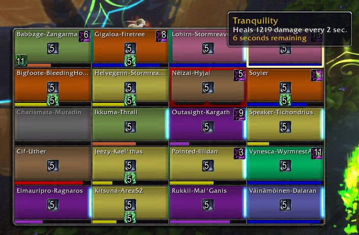
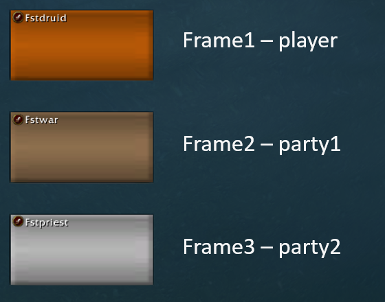
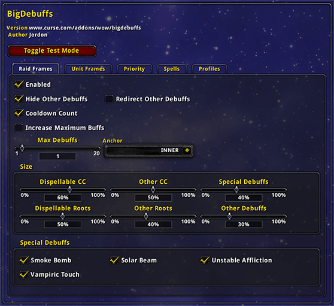

# Plugins for Compact Raid Frame (WotLK 3.3.5a)

<a href="../../README.md#contents"> Back to contents</a>

> **Requires: [Compact Raid Frame](https://gitlab.com/tsoukie-3.3.5/compactraidframe/-/archive/main/compactraidframe-main.zip) and [ClassicAPI](https://gitlab.com/tsoukie-3.3.5/classicapi/-/archive/main/classicapi-main.zip) installed and enabled.**

## Plugins

### Enhanced Raid Frames

A Compact Raid Frame plugin that adds configurable aura indicators, range settings, frame scale and opacity controls, and target icons.

🔗 [Download](https://gitlab.com/tsoukie-3.3.5/enhancedraidframes/-/archive/main/enhancedraidframes-main.zip) &nbsp;|&nbsp; 💻 [GitLab](https://gitlab.com/tsoukie-3.3.5/enhancedraidframes)

---

### FrameSort

A Compact Raid Frame plugin that sorts units by group, role, or name; places or hides the player frame; adjusts spacing; and provides targeting keybinds and macro variables based on visual frame position.

🔗 [Download](https://gitlab.com/tsoukie-3.3.5/framesort/-/archive/main/framesort-main.zip) &nbsp;|&nbsp; 💻 [GitLab](https://gitlab.com/tsoukie-3.3.5/framesort)

---

### BigDebuffs

BigDebuffs makes important crowd-control and defensive effects easier to see by placing duration icons on unit frames and enlarging priority debuffs on Compact Raid Frame.

🔗 [Download](https://gitlab.com/tsoukie-3.3.5/bigdebuffs/-/archive/main/bigdebuffs-main.zip) &nbsp;|&nbsp; 💻 [GitLab](https://gitlab.com/tsoukie-3.3.5/bigdebuffs)

---

<a href="../../README.md#contents"> Back to contents</a>
